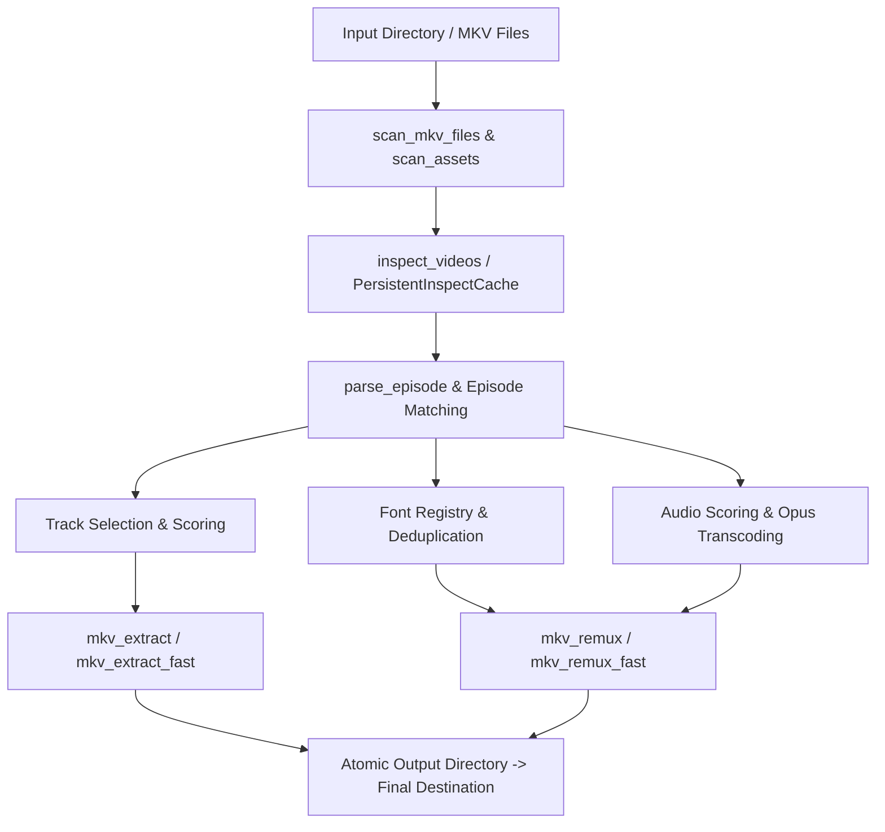

# AGENTS.md - `mkvanimebatch` AI Developer & Agent Guide

Welcome to **`mkvanimebatch`**! This document provides AI coding agents and human developers with essential instructions, codebase context, architecture diagrams, command shortcuts, and design rules for working within this repository.

---

## 📌 Repository Overview

`mkvanimebatch` is an automated, high-performance batch processing suite written in Python and Tauri/Rust for anime and fansub MKV collections. It automates:
- Subtitle track scoring, format detection (`.ass` typesetting vs `.srt`), language prioritization (Indonesian `ind`/`id`, English `eng`/`en`), and subtitle timestamp shifting.
- 10-Tier Audio scoring and selection (dialogue track vs audio commentary separation, Opus audio re-encoding).
- Font extraction, deduplication, and attachment embedding.
- External chapter XML and cover image discovery.
- Thread-pooled multi-threaded batch operations with bounded disk I/O queues and atomic output safety.
- Cross-platform desktop interface (`desktop-tauri`).

---

## 📂 Codebase Directory Map

```
mkvanimebatch/
├── mkv_common.py            # Core domain logic: episode parsing, track scoring, font registry, sub shifting
├── mkv_common_fast.py       # Multi-threading utilities: ThreadPoolExecutor, disk I/O semaphores, batch tasks
├── mkv_extract.py           # Standard sequential subtitle, font, cover, chapter extraction pipeline
├── mkv_extract_fast.py      # High-performance parallel extraction CLI launcher
├── mkv_remux.py             # Standard sequential MKV remuxing & Opus transcoding pipeline
├── mkv_remux_fast.py        # High-performance parallel remuxing CLI launcher
├── README.md                # User documentation & feature reference
├── GRAPH_REPORT.md          # Architectural graph report & module dependency visualization
├── run.bat / run.ps1        # Interactive Windows batch/PowerShell launchers (Standard)
├── run_fast.bat / .ps1      # Interactive Windows batch/PowerShell launchers (Parallel)
├── tests/                   # Pytest test suite (325+ tests covering all sub-modules)
│   ├── conftest.py          # Shared test fixtures (mock MKVs, temp dirs)
│   ├── test_asset_indices.py
│   ├── test_audio_picker.py
│   ├── test_cache_concurrency.py
│   ├── test_dir_traversal.py
│   ├── test_episode_parser.py
│   ├── test_extraction_safety.py
│   ├── test_font_registry.py
│   ├── test_output_paths.py
│   ├── test_performance_features.py
│   ├── test_remux_args.py
│   ├── test_smoke_cli.py
│   ├── test_sub_index.py
│   ├── test_subtitle_shift.py
│   └── test_track_selection.py
└── desktop-tauri/           # Desktop GUI app built with Tauri & Rust
    ├── src-tauri/           # Rust backend & sidecar launchers
    ├── ui/                  # Web frontend interface
    ├── build-sidecars.sh    # Sidecar compilation script (Linux/macOS)
    └── build-sidecars.ps1   # Sidecar compilation script (Windows)
```

---

## 🛠️ Verification & Test Suite Commands

Agents **MUST** run tests to verify any code modifications before claiming success.

### 1. Test Suite Execution
```bash
# Run the full pytest test suite (325+ unit tests)
python3 -m pytest

# Run with detailed output / verbosity
python3 -m pytest -v

# Run a specific test module
python3 -m pytest tests/test_track_selection.py

# Run a specific test function
python3 -m pytest tests/test_episode_parser.py -k "test_parse_episode"
```

### 2. Runtime Dependencies
The core tool suite relies on external system executables:
- `python3` (3.10+)
- `mkvmerge` & `mkvextract` (from MKVToolNix)
- `ffmpeg` (for Opus audio transcoding)

---

## 🏗️ Core Architecture & Data Flow



### Key Modules & Responsibilities

1. **`mkv_common.py`**:
   - `parse_episode(path)`: Robust regex episode parsing supporting `SxxExx`, `EPxx`, `v2`, Specials (`S00`), movies, and OVA tags.
   - `select_best_subtitle_track(...)`: Scores subtitle tracks by language (primary: `ind`/`id`, fallback: `eng`/`en`), dialogue status, and format (`.ass` vs `.srt`).
   - `FontRegistry`: Discovers, indexes, and deduplicates font files by MIME type and filename.
   - `shift_ass_timestamps(...)`: Subtitle timestamp shifting with UTF-8 BOM (`utf-8-sig`) preservation.
   - `PersistentInspectCache`: Thread-safe json probe caching (`.mkv_inspect_cache.json`).
   - `ScanResults` & `resolve_output_dir`: Preserves nested subdirectory structures under `--out-dir`.

2. **`mkv_common_fast.py`**:
   - `WorkerPoolExecutor`: Thread-pool wrapper handling bounded concurrency (`--workers` and `--io-jobs`).
   - Atomic staging directory setup and cleanup guards.

3. **`mkv_extract_fast.py` & `mkv_remux_fast.py`**:
   - Multi-threaded CLI tools wrapping `mkv_common` with CLI argument parsing via `argparse`.

---

## 🎨 Coding Guidelines & Agent Conventions

1. **Python 3.10+ Type Annotations**:
   - Always use standard modern Python typing (`from __future__ import annotations`, `list[str]`, `dict[str, Any]`, `Path | str`).

2. **Atomic File Safety**:
   - Never write directly to target output files. Always stage output files into temporary working directories (e.g. `.tmp_job_*`) and perform an atomic rename/move upon process success.

3. **Thread Safety & Locking**:
   - Global or shared state (like `PersistentInspectCache`) must acquire standard threading locks (`threading.Lock()`) when reading or updating state across threads.

4. **Error Handling & Logs**:
   - Do not swallow exceptions silently. Log failures via `logger.error(...)` or `logger.warning(...)`.
   - Preserve process exit code contracts so automated batch scripts detect failures.

5. **No Regressions**:
   - Maintain full test coverage. Ensure all 325+ tests pass with `python3 -m pytest` after making changes.

---

## 💬 Slash Commands & Helper Tools

When interacting with users, you can recommend relevant slash commands:
- `/plan`: For planning complex refactors or features before execution.
- `/grill-me`: To conduct an interactive interview to align on design decisions.
- `/goal`: For running long-running batch processing or thorough testing tasks.

## Agent skills

### Issue tracker

GitHub issues (via `gh` CLI). See `docs/agents/issue-tracker.md`.

### Triage labels

Default triage labels (`needs-triage`, `needs-info`, `ready-for-agent`, `ready-for-human`, `wontfix`). See `docs/agents/triage-labels.md`.

### Domain docs

Single-context (repo root `CONTEXT.md`). See `docs/agents/domain.md`.
