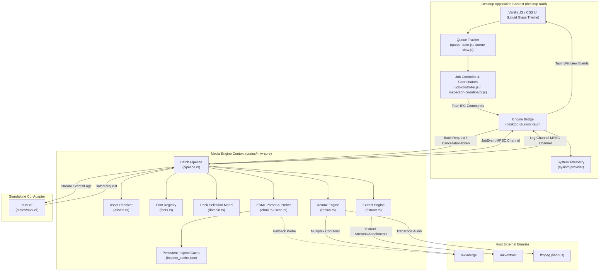
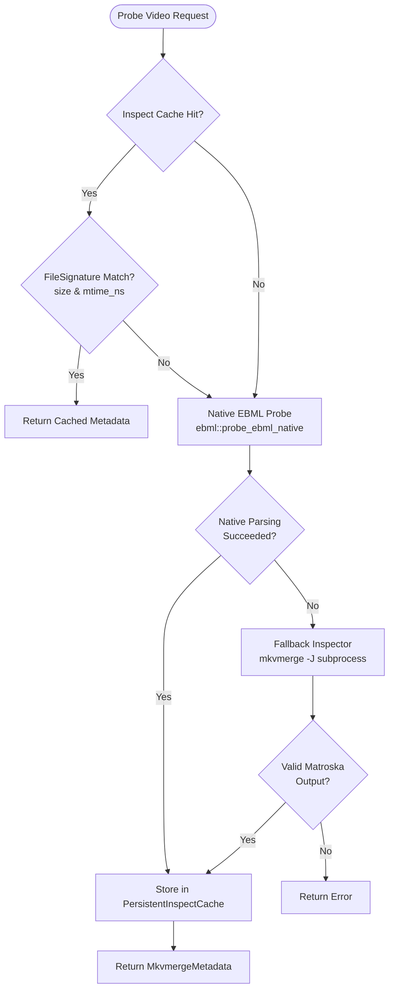
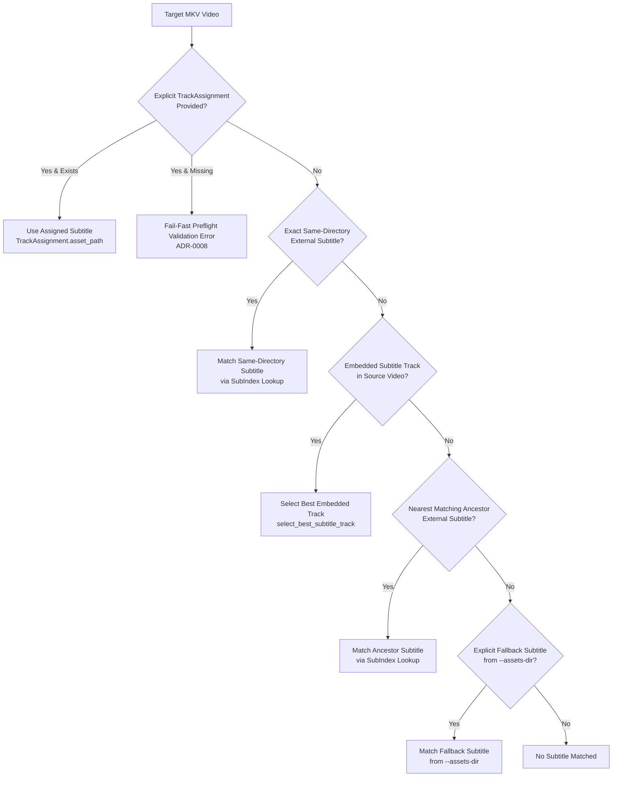
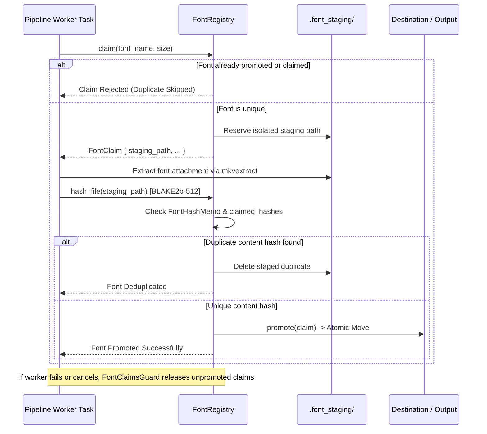
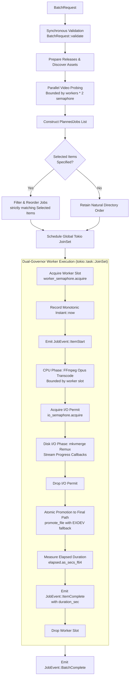
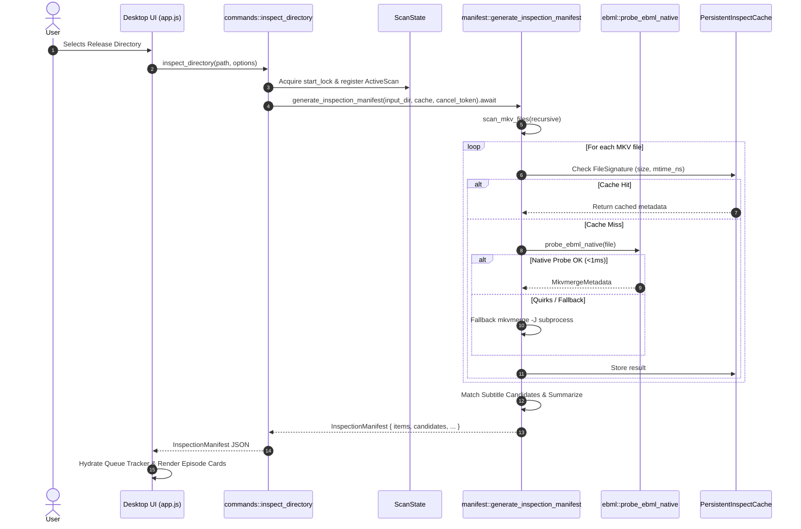
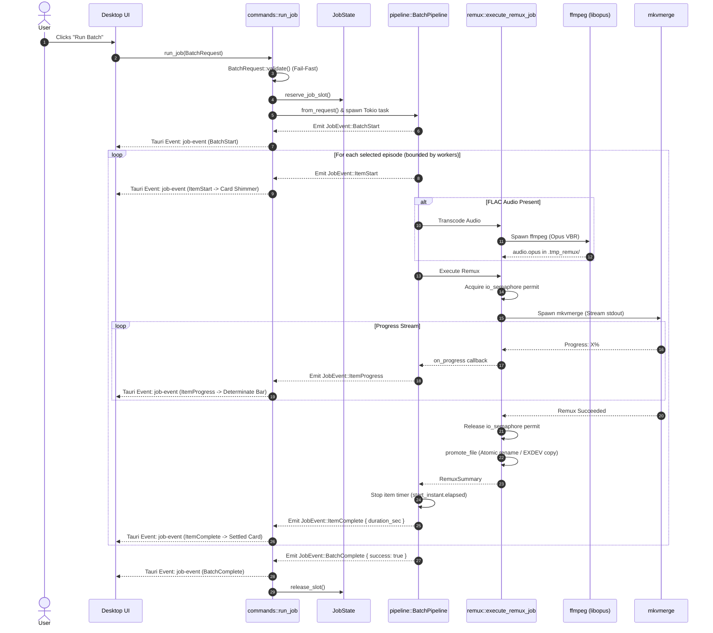

# System Architecture Specification (`mkvanimebatch`)

> **Version**: 1.0.0  
> **Status**: Production / Active  
> **Topology**: Pure Rust Workspace (Crates + Tauri v2 Desktop GUI + Standalone CLI)  
> **Reference Contexts**: [Context Map](./CONTEXT-MAP.md) · [Media Engine](./crates/mkv-core/CONTEXT.md) · [Desktop Application](./desktop-tauri/CONTEXT.md)

---

## 1. Executive Summary & System Vision

**`mkvanimebatch`** is a high-performance, automated batch processing engine and desktop application purpose-built for anime fansub collections. Managing fansub releases involves significant domain complexity: multi-track Matroska containers, fragmented external subtitle revisions, complex multi-directory season arrangements, duplicate font attachments across episodes, disparate audio encodings, and subtitle time synchronization offsets.

Traditional workflows rely on fragile shell scripts or manual interaction with GUI tools like MKVToolNix GUI. `mkvanimebatch` provides an end-to-end, resilient system that addresses these challenges through:

1. **Hybrid EBML Inspection**: Ultra-fast pure-Rust Matroska container probing (`<1ms` per file) with transparent fallback to `mkvmerge -J` when encountering container quirks.
2. **Domain-Specific Fansub Heuristics**: Automatic episode identification, 10-tier audio scoring (favoring Japanese stereo dialogue while isolating commentary tracks), and language-aware subtitle selection (prioritizing Indonesian and English ASS typesetting).
3. **Transactional Font Registry**: BLAKE2b content-hash deduplication and two-phase font staging (`claim` → `stage` → `promote`/`release`) that completely prevents font collision and redundant container bloat.
4. **Dual-Governor Concurrency Pipeline**: Fine-grained asynchronous pipelining balancing CPU-intensive audio transcoding (Opus via FFmpeg) with disk-I/O-throttled multiplexing (`mkvmerge`).
5. **Crash-Resistant Atomic Execution**: Isolated temporary scratch directories, atomic file promotion across filesystem boundaries (`EXDEV` resilience), and automatic cleanup of interrupted operations.
6. **Unified Dual-Context Topology**: A shared, pure-Rust domain engine (`crates/mkv-core`) consumed directly in-process by a native Tauri v2 desktop GUI (`desktop-tauri`) and a standalone terminal CLI (`crates/mkv-cli`).

---

## 2. Context Map & Domain Language

The system is partitioned into two distinct **Bounded Contexts** connected via an in-process integration layer, following Domain-Driven Design (DDD) principles.



### Ubiquitous Language & Core Terminology

The canonical vocabulary for this system lives with the context that owns it, not here:

- [Media Engine Context](./crates/mkv-core/CONTEXT.md) — 21 terms covering release discovery, asset resolution, track scoring, fonts, and the execution model.
- [Desktop Application Context](./desktop-tauri/CONTEXT.md) — 10 terms covering queue projection, the Engine Bridge, and the desktop coordinators.

Terms both contexts use are defined **once**, by the context that produces them, and linked from the consumer. That is deliberate: this section previously held a third copy of the glossary which had already drifted from both sources — it omitted six desktop terms and carried a truncated Track Assignment definition. A definition with no owner is a definition that will drift again.

---

## 3. Workspace Topology & Module Organization

The codebase is organized as a Cargo workspace with unified versioning (`1.0.0`) under edition 2021:

```
mkvanimebatch/
├── Cargo.toml                       # Workspace root manifest (crates/mkv-core, crates/mkv-cli, desktop-tauri/src-tauri)
├── CONTEXT-MAP.md                   # System-wide context boundaries and relationships
├── AGENTS.md                        # Agent workflow guidelines, CI gates, and review rules
├── README.md                        # User guide and CLI/GUI reference
├── docs/
│   ├── adr/                         # Architectural Decision Records (0001 - 0014)
│   └── agents/                      # Domain modeling and issue tracker documentation
├── crates/
│   ├── mkv-core/                    # Pure-Rust Core Domain & Batch Processing Engine
│   │   ├── Cargo.toml
│   │   ├── CONTEXT.md               # Media Engine Bounded Context definition
│   │   ├── src/
│   │   │   ├── lib.rs               # Library root re-exports
│   │   │   ├── domain.rs            # Episode parsing, natural sort, track scoring, atomic file promotion
│   │   │   ├── cpu.rs               # Physical core topology (/proc/cpuinfo) & transcode thread governor
│   │   │   ├── ebml.rs              # Lightweight native EBML/Matroska container parser
│   │   │   ├── scan.rs              # Asset discovery, video inspection, symlink-aware traversal, PersistentInspectCache
│   │   │   ├── assets.rs            # AssetResolver, SubIndex, ChapterIndex, CoverIndex, ancestor traversal
│   │   │   ├── fonts.rs             # FontRegistry, BLAKE2b deduplication, FontHashMemo, transactional staging
│   │   │   ├── manifest.rs          # Preflight InspectionManifest generation and metadata summarization
│   │   │   ├── preset.rs            # PresetProfile definitions and catalog lookups
│   │   │   ├── request.rs           # BatchRequest, TrackAssignment validation, path sanitization
│   │   │   ├── remux.rs             # FFmpeg Opus transcoding, ASS sync shifting, mkvmerge execution
│   │   │   ├── extract.rs           # mkvextract invocation for subtitles, chapters, covers, and fonts
│   │   │   └── pipeline.rs          # BatchPipeline orchestration, tokio JoinSet, dual-channel streaming
│   │   ├── benches/                 # bench_pipeline.rs (validation throughput, dry-run, font dedup, event streaming)
│   │   └── tests/                   # 11 integration suites: test_assets, test_cross_regex, test_domain, test_extract, test_fonts, test_pipeline, test_pipeline_assignments, test_pipeline_assignment_args, test_real_remux, test_remux, test_scan
│   └── mkv-cli/                     # Headless Standalone CLI Binary
│       ├── Cargo.toml
│       └── src/
│           └── main.rs              # CLI entry point, arg parsing, terminal formatting, symlink dispatch
└── desktop-tauri/                   # Desktop GUI Application (Tauri v2 + Webview)
    ├── CONTEXT.md                   # Desktop Application Bounded Context definition
    ├── src-tauri/
    │   ├── Cargo.toml
    │   ├── tauri.conf.json          # Tauri v2 application configuration
    │   ├── capabilities/            # Security capabilities & IPC permission schemas
    │   └── src/
    │       ├── lib.rs               # Application entry point, Linux Wayland/WebKitGTK mitigations
    │       ├── main.rs              # Binary bootstrap
    │       ├── commands.rs          # Tauri command handlers (run_job, stop_job, inspect_directory, etc.)
    │       ├── contract.rs          # Serialization types matching mkv-core contracts
    │       ├── process.rs           # Engine Bridge state management, panic isolation, JobSnapshot projection
    │       ├── telemetry.rs         # sysinfo hardware telemetry (CPU, RAM, engine child process I/O)
    │       └── window.rs            # Frameless window controls, resize/drag operations, theme persistence
    └── ui/                          # Frontend Presentation Layer (Vanilla ECMAScript & CSS)
        ├── index.html               # Application shell, layout, modals, drawers
        ├── style.css                # Liquid Glass styling, layout grid, typography, cards
        ├── os-detect.js             # Platform OS detection (CSP-safe external script)
        ├── app.js                   # Main application initialization and tab lifecycle
        ├── queue-state.js           # QueueTracker state machine and JobEvent reduction
        ├── queue-view.js            # Virtualized DOM rendering of episode cards and controls
        ├── job-controller.js        # Form validation, run/stop trigger, and preset synchronization
        ├── job-coordinator.js       # Cross-mode job concurrency coordinator
        ├── inspection-coordinator.js# Debounced directory scanning and manifest loading
        ├── telemetry.js             # Live hardware telemetry ticker and gauge rendering
        ├── log-classify.js          # Terminal drawer line classification (stdout, stderr, info, warn, err)
        └── *.test.js                # Node test suites for frontend modules
```

---

## 4. Media Engine Deep Dive (`crates/mkv-core`)

The `mkv-core` crate is a self-contained, panic-free library that models all domain rules and executes fansub pipelines.

### 4.1 Hybrid EBML Probing & Inspection Subsystem



1. **Native Pure-Rust Parser (`ebml.rs`)**:
   - Parses EBML Header (`0x1A45DFA3`) and Matroska Segment (`0x18538067`).
   - Traverses the `SeekHead` index (`0x114D9B74`) to locate `Tracks` (`0x1654AE6B`), `Attachments` (`0x1941A469`), and `Chapters` (`0x1043A770`).
   - Decodes EBML Variable Size Integers (VINT) with safe zero-check validations.
   - Extracts track properties: `TrackNumber`, `TrackType` (video, audio, subtitle), `CodecID`, `Language` (including BCP-47 `LanguageIETF`), `Name`, `PixelWidth`, `PixelHeight`, and `AudioChannels`.
   - Extracts attachment metadata: `FileName`, `FileMimeType`, and file data size.
   - **Performance**: Completes in `<1.0ms` per file, eliminating process spawning overhead for directory scans.

2. **Transparent Fallback Inspector (`scan.rs`)**:
   - If native parsing fails (e.g. unknown proprietary container extensions, corrupted cluster headers, missing SeekHead with trailing clusters), the probe seamlessly falls back to `mkvmerge -J`.
   - On Windows, `mkvmerge` is executed with `CREATE_NO_WINDOW` (`0x08000000`) to prevent console window flicker.

3. **Persistent Inspection Cache (`PersistentInspectCache`)**:
   - Keyed on normalized file path and verified against `FileSignature { size: u64, mtime_ns: u128 }`.
   - Thread-safe storage guarded by `parking_lot::Mutex`.
   - Persists to OS-appropriate directory (`$LOCALAPPDATA/mkvanimebatch/inspect_cache.json` on Windows, `~/.cache/mkvanimebatch/inspect_cache.json` on Linux) using atomic replacement via `NamedTempFile` to avoid cache corruption.

---

### 4.2 Asset Resolution & Fansub Heuristics

Anime releases often distribute external subtitle revisions (`.ass`), XML chapters, and posters across parent directories. The `AssetResolver` implements strict discovery and matching rules:



1. **Resolution Precedence Ladder (ADR-0004 & ADR-0008)**:
   - **Tier 1 (Manual Assignment)**: Explicit `TrackAssignment` submitted by the user. If the file is missing or invalid on disk, preflight **fails fast** immediately.
   - **Tier 2 (Same-Directory External)**: Exact same-directory external subtitle beside the video matching the episode identity.
   - **Tier 3 (Embedded Track)**: Best embedded subtitle track inside the MKV container.
   - **Tier 4 (Nearest Ancestor External)**: External subtitle found in the nearest matching ancestor directory.
   - **Tier 5 (Explicit Assets Fallback)**: External subtitle from explicit `--assets-dir` fallback directory.
   - *Source Precedence Principle*: Source hierarchy strictly beats language score across sources (e.g. an adjacent English subtitle beats an embedded Indonesian track, but a parent English subtitle does not displace an embedded Indonesian track; nearest matching ancestor outranks explicit `--assets-dir`).

2. **Episode Identity Parsing (`parse_episode`)**:
   - Evaluates multi-pattern regexes for standard notation (`S01E02`, `S1E2`), season markers (`Season 1`), type qualifiers (`OVA`, `OAD`, `ONA`, `Special`, `SP`), and fansub delimiter brackets (`[02]`, `- 02`).
   - Supports fractional episode numbers (`01.5`, `02.5`, `00.CM`) without truncation (ADR-0004).

3. **Subtitle Scoring Model (`score_subtitle_category`)**:
   - Format: Advanced SubStation Alpha (`.ass` / `.ssa`) is strictly preferred over SubRip (`.srt`) or bitmap formats (PGS/VobSub).
   - Language Tiering:
     - Indonesian (`ind`, `id`) ASS: **12 / 11** | SRT: **6 / 5**
     - Undetermined (`und`) ASS: **10** | SRT: **4**
     - English (`eng`, `en`) ASS: **9 / 8** | SRT: **3 / 2**
     - Other languages ASS: **7** | SRT: **1**
   - Dialogue vs Commentary: Tracks containing dialogue keywords (`full`, `dialogue`, `main`, `complete`, `indo`) gain priority; commentary keywords (`commentary`, `ad`, `audio description`) are filtered out.

4. **10-Tier Audio Selection Model (`select_audio_track`)**:
   - Commentary tracks (`\b(commentary|comment|audio\s+description|ad|extension)\b`) are quarantined into a fallback pool.
   - Primary Pool Scoring:
     - **Tier 10**: Japanese Stereo Dialogue (`ja`/`jpn` + 2ch + dialogue name)
     - **Tier 9**: Japanese Stereo (`ja`/`jpn` + 2ch)
     - **Tier 8**: Japanese Multi-Channel (`ja`/`jpn` > 2ch)
     - **Tier 7**: Undetermined Stereo Dialogue (`und` + 2ch + dialogue name)
     - **Tier 6**: Undetermined Stereo (`und` + 2ch)
     - **Tier 5**: Undetermined Multi-Channel (`und` > 2ch)
     - **Tier 4**: Non-Japanese Stereo Fallback
     - **Tier 3**: First Audio Stream After Video Track
     - **Tier 2**: Japanese Commentary Fallback
     - **Tier 1**: First Audio Stream (Last Resort)
   - Tie-breaking: Evaluates `-(track.pos as i64)`, guaranteeing that earlier container streams win ties deterministically.

5. **Chapter & Cover Matching Conventions (ADR-0004)**:
   - Chapters: Matches episode-named XML chapters (`<ep>_chapters.xml`). Leftover unassociated XML chapters in the release directory are automatically claimed only if exactly one unmatched chapter file and one eligible un-chaptered video exist (`claim_leftover_chapters`). Ambiguous groups of multiple unmatched chapters or un-chaptered videos remain unclaimed; no arbitrary natural sort pairing is performed.
   - Covers: Directory covers are strictly `cover.<ext>` and `folder.<ext>`. Episode covers support `<video-stem>_cover.<ext>`, `<video-stem>.cover.<ext>`, and exact adjacent `<video-stem>.<ext>`. Inapplicable `*_cover` files are never treated as directory covers. Nearest applicable directory wins before cover kind. Within a directory, ranking follows: episode `_cover` > `.cover` > exact adjacent bare stem > directory `cover` > `folder`. The bare-stem form additionally requires the identical parent directory, so a root bare cover never attaches to a nested same-stem video. Because the fallback index ranks by the assets directory's own layout rather than the video's ancestors, this also means a bare-stem cover inside `--assets-dir` only matches a video that lives in that same directory; use the `cover.<ext>`/`folder.<ext>` or `_cover`/`.cover` forms for cross-directory `--assets-dir` covers. Equal-tier candidates break ties by natural filename order then full filename. Local and ancestor external covers supersede embedded artwork; explicit `--assets-dir` covers apply only when embedded art is absent.

---

### 4.3 Transactional Font Registry & Deduplication (`fonts.rs`)

When remuxing anime series (12–24 episodes), multiple episodes share identical subtitle fonts. Re-extracting and re-embedding fonts redundantly causes severe disk I/O bottlenecks and bloats files.



1. **Transactional Arbitration**:
   - **Claim Phase**: Worker registers intent by `(font_name, size)`. If another worker holds an active claim or has promoted the font, duplicate extraction is suppressed.
   - **Staging Phase**: Extracted font binaries write into isolated scratch paths (`.font_staging/`).
   - **Content Hash Verification**: Computes a BLAKE2b-512 hash (`hash_file`) of the staged binary. The hash is checked against `FontHashMemo` (persisting signatures to `font_hash_memo.json` in the default cache dir or configured via `PipelineConfig` to bypass BLAKE2b hashing for existing and promoted fonts across batch extraction runs) to catch identical fonts named differently.
   - **Promote Phase**: Moves the staged font to the final destination directory with collision-free renaming.
   - **RAII Release Safety**: The `FontClaimsGuard` implements `Drop`. If a worker terminates, panics, or cancels before promotion, uncommitted claims are automatically revoked.
   - **Mode-Specific Font Handling**: Extraction mode (`extract.rs`) extracts and retains fonts as user output in the target destination. Remux mode (`remux.rs`) discovers and attaches fonts into output Matroska files. Staging directories are transactionally cleaned up (`FontRegistry::cleanup_staging()`), and deduplication prevents redundant font extraction. The inert `keep_fonts` setting has been removed across the system.

---

### 4.4 Remux & Transcode Orchestration (`remux.rs`)

The remux subsystem translates high-level planned jobs into optimized external tool executions.

1. **Audio Transcoding (FLAC to Opus)**:
   - When an audio stream is lossless FLAC (`A_FLAC`), the engine invokes `ffmpeg` with `libopus`:
     - Rate Control: Variable Bitrate (`-vbr on`)
     - Bitrate: Configured by `PresetProfile` or `--bitrate` override (e.g. `192k`)
     - Compression Complexity: `0-10` (`5` default, `10` on HiFi; ADR-0013 downshifted the default from 10, saving ~40% CPU per episode)
     - Threading: defaults to `auto` via the transcode governor (`cpu::transcode_governor_threads`: `(physical_cores / workers).clamp(1, 4)`); explicit `--ffmpeg-threads N` overrides it
     - Timeout: Guarded by 30-minute subprocess timeout (`SUBPROCESS_TIMEOUT`)
2. **Subtitle Synchronization**:
   - Subtitle time shifts (`offset_ms` or global `sub_offset`) are applied via `mkvmerge --sync <track_id>:<offset_ms>`.
   - Precedence: Per-item `custom_offset_ms` from `TrackAssignment` overrides global `sub_offset`.
   - Negative and positive millisecond offsets are passed directly to mkvmerge container-level track synchronization.
3. **MKVMerge Argument Generation (`build_mkvmerge_args`)**:
   - Maps video track (`--video-tracks <id>`), transcoded or untouched audio (`--audio-tracks <id>`), and external/embedded subtitles (`--subtitle-tracks <id>`).
   - Injects track language tags (`--language <id>:<iso639-2>`), default flags (`--default-track-flag`), and track titles.
   - Attaches deduplicated fonts with MIME types (`--attachment-mime-type`, `--attach-file`).
   - Attaches front cover art (`--attach-file <cover>`).
   - Injects XML chapter definitions (`--chapters <file>`).

---

### 4.5 Batch Pipeline Concurrency & Execution (`pipeline.rs`)

`BatchPipeline` manages execution scheduling across entire release trees.



1. **Dual-Governor Resource Throttling (ADR-0011)**:
   - **Worker Concurrency (`workers`)**: Bounds the total number of simultaneous episode pipelines running in Tokio async tasks.
   - **I/O Semaphore (`io_jobs`)**: Bounds the number of concurrent processes performing heavy disk writing (`mkvmerge` / `mkvextract`). Audio transcoding proceeds in parallel across worker slots, but muxing waits for an I/O permit, preventing disk head thrashing and scratch space exhaustion.
2. **Global Work Pipelining (ADR-0011)**:
   - Planned jobs across all release subdirectories are flattened into a single global queue, eliminating worker starvation at directory boundaries while preserving directory-scoped asset resolution.
3. **Cooperative Cancellation (`CancellationToken`)**:
   - Checked at every major pipeline boundary: preflight inspection, before task launch, between transcode and muxing, and inside stream readers.
   - On cancellation, active child processes (`kill_on_drop(true)`) are terminated immediately, and staging files are cleaned up.
4. **Authoritative Monotonic Item Duration (ADR-0009)**:
   - The engine captures `let start = Instant::now()` at task entry and calculates `start.elapsed().as_secs_f64()` upon completion. This value is embedded into `JobEvent::ItemComplete { duration_sec: Some(f64), .. }`.

---

## 5. Desktop Application Architecture (`desktop-tauri`)

The desktop application is built with Tauri v2, pairing a Rust backend host with a webview frontend styled in a custom **Liquid Glass** dark aesthetic.

```mermaid
flowchart LR
    subgraph Frontend["Webview Frontend (desktop-tauri/ui)"]
        UIApp["app.js\nInit & Tabs"]
        UIQueue["queue-state.js\nQueue Tracker"]
        UIView["queue-view.js\nDOM Rendering"]
        UIJob["job-controller.js\nIPC Trigger"]
        UITel["telemetry.js\nHardware Gauges"]
    end

    subgraph RustBridge["Engine Bridge (src-tauri/src/)"]
        Cmds["commands.rs\nTauri Commands"]
        Proc["process.rs\nJobState & ScanState"]
        Telem["telemetry.rs\nsysinfo Collector"]
        Win["window.rs\nFrameless Window"]
    end

    subgraph CoreEngine["Media Engine (crates/mkv-core)"]
        CorePipe["pipeline::BatchPipeline"]
        CoreScan["manifest::generate_inspection_manifest"]
    end

    UIApp --> UIJob
    UIJob -->|inspect_directory| Cmds
    UIJob -->|run_job(BatchRequest)| Cmds
    UIJob -->|stop_job| Cmds
    UITel -->|get_system_telemetry| Cmds

    Cmds --> Proc
    Cmds --> Telem
    Cmds --> Win

    Cmds -->|async .await| CoreScan
    Proc -->|tokio::spawn| CorePipe

    CorePipe -->|JobEvent MPSC| Proc
    CorePipe -->|Log Line MPSC| Proc
    Proc -->|emit job-event| UIQueue
    Proc -->|emit job-log| UIApp
    UIQueue --> UIView
```

### 5.1 In-Process Engine Bridge & Process Lifecycle (`process.rs`)

The legacy Python PyInstaller sidecar architecture was superseded by the **in-process Engine Bridge** (ADR-0007, ADR-0008). Exposed Tauri commands: `inspect_directory`, `run_job`, `stop_job`, `clear_cache`, `pick_directory`, `pick_subtitle_file`, `get_preset_profiles`, `get_job_snapshot`, `get_system_telemetry`, plus window controls (`minimize_window`, `toggle_maximize`, `is_maximized`, `start_drag`, `start_resize`, `set_window_theme`) and shutdown orchestration (`begin_shutdown`, `cancel_shutdown`, `close_window`, `cleanup_owned_processes`).

1. **Zero-IPC Overhead**: The Media Engine runs directly inside the desktop process. Communication uses in-memory Tokio MPSC channels rather than OS pipes or NDJSON streams.
2. **Job Slot Arbitration & Panic Isolation**:
   - `JobState` enforces mutual exclusion via `JobSlot`: only one active batch execution can run at a time.
   - Pipeline execution is isolated inside `tauri::async_runtime::spawn`. An unexpected panic within the engine is intercepted at the `JoinHandle` boundary, preventing desktop application crashes and releasing the slot safely.
3. **Two-Phase Teardown Protocol (ADR-0007)**:
   - When a user stops a job or closes the window during execution:
     - **Phase 1 (Cooperative)**: Fires `cancel_token.cancel()`. Waits up to 2.0 seconds (`STOP_TIMEOUT`) for active child processes (`ffmpeg`, `mkvmerge`) to exit and temporary files to be cleaned up.
     - **Phase 2 (Hard Abort)**: If the worker fails to exit within 2.0 seconds, only the pipeline worker is aborted via `slot.pipeline_abort.abort()`. The supervisor task survives to publish the cancelled terminal snapshot and `job-done`, then release the slot.
4. **Real-Time `JobSnapshot` Projection (ADR-0008, ADR-0009)**:
   - The bridge reduces incoming `JobEvent` streams into an in-memory `JobSnapshot`.
   - The webview queries `get_job_snapshot()` upon initialization to immediately restore completed cards, execution outcomes, and exact run durations across reloads.
5. **Canonical Directory Identity**:
   - Every directory identity crossing the bridge into the Queue Tracker is the **display form** of the canonical path: a Windows verbatim (`\\?\`) prefix is stripped and `\\?\UNC\` is rewritten to `\\` (`commands.rs`, `display_canonical_path`).
   - This applies to the Inspection Manifest's `canonical_dir`, the Job Snapshot's `input_dir`, and `JobEvent::BatchStart.input_dir`. The engine still receives and uses the real `PathBuf` for filesystem work; only the projected form is normalized, in the bridge.
   - The three must agree because Queue Tracker directory identity is a string comparison. A mismatch — for example a raw verbatim `BatchStart.input_dir` against a stripped `canonical_dir` — silently drops Queue Selection and Active Batch ordering on the next same-directory rescan, because a release directory whose name ends in `.` or a space normalizes differently in each form.
6. **Linux Desktop Environment Hardening (`lib.rs`)**:
   - Enforces `GDK_BACKEND=x11,wayland` to avoid `EGL_BAD_PARAMETER` aborts under native Wayland.
   - Inside AppImages on modern Linux distributions (Fedora, Arch, Ubuntu 24+), dynamically injects host `libwayland-client.so.0` via `LD_PRELOAD` to resolve ABI symbol conflicts between bundled and host graphics drivers, and disables WebKitGTK DMABUF rendering (`WEBKIT_DISABLE_DMABUF_RENDERER=1`) to prevent Mesa EGL exit segfaults (`SkiaGLContext` teardown race condition).
   - The DMABUF workaround is scoped to AppImage deliberately and must not be widened to native packages. On RPM/DEB installs running WebKitGTK 2.54+, disabling DMABUF drops Skia to CPU shared-memory rendering; the window is `transparent: true`, so only pointer-damaged regions recomposite and the rest of the window shows the desktop through it. Native packages therefore keep DMABUF enabled.
   - `init_linux_env()` only ever *defaults* these variables; an operator who exported `WEBKIT_DISABLE_DMABUF_RENDERER=1` to work around the original shutdown segfault keeps that override and so keeps the rendering bug. The fix for that operator is to unset the variable, not to widen the default.

---

### 5.2 System Telemetry Engine (`telemetry.rs`)

A background polling service provides live hardware metrics at 1-second intervals:

1. **Targeted Process Inspection**:
   - Uses `sysinfo::System`. When an engine task is running, inspects all processes to compute aggregated CPU and disk I/O metrics.
   - **Parent PID Filtering**: Specifically isolates CPU and disk write rates (`io_mb_s`) generated by the application process and its direct child media tools (`is_engine_process` matching `mkvmerge`, `mkvextract`, `ffmpeg`), filtering out background system noise.
2. **Minimal Overhead**:
   - When idle, process inspection refreshes only the host PID (`ProcessesToUpdate::Some(&[self_pid])`).

---

### 5.3 Presentation & Queue State Architecture (`ui/`)

The frontend avoids heavy framework bloat (React/Vue), implementing a high-speed, modular vanilla ECMAScript architecture:

1. **State Machine (`queue-state.js`)**:
   - `createQueueState(manifest)` initializes state records strictly keyed by `item.id`.
   - `reduceQueueEvent(state, event)` updates item state records in place ($O(1)$ per event) without allocating new trees.
   - Supports queue reordering (`▲` / `▼`) and selective execution (`selected_items`).
2. **Incremental Manifest Card & Event Rendering (`queue-view.js`, `app.js`)**:
   - Initial Inspection Manifest cards are created in `requestAnimationFrame` batches under a best-effort ~8 ms deadline (`QueueTracker.renderCardsIncrementally` in `queue-view.js`) so large manifests do not block the main thread.
   - Live progress updates render synchronously on mounted cards when the event arrives; cards not yet mounted render from the item's current reducer state when created. Terminal log batches are flushed in a single animation frame. Neither has a hard per-update frame budget or a constant 60 FPS guarantee.
3. **Hybrid Visual Progress Lifecycle (ADR-0009)**:
   - **Indeterminate Shimmer**: Displayed during initialization, EBML probing, and audio transcoding when exact byte progress is unavailable.
   - **Determinate Progress Bar**: Transitions immediately upon receiving the first `ItemProgress { progress, speed, eta }` event from `mkvmerge`, mapping to a determinate percentage fill.
   - **Terminal State**: Settles to 100% on `ItemComplete` with success, error, or cancelled styling.
4. **Centralized Presentation Heartbeat (ADR-0009)**:
   - A single 1Hz timer in `QueueTracker` coordinates elapsed duration tickers across all active in-flight cards, eliminating per-card `setInterval` drift and DOM thrashing.
   - Stops ticking when no items are active.
5. **Enriched Track Assignment Modal (ADR-0011, ADR-0012)**:
   - Provides full override control: browse external subtitle files (`rfd` native dialog), select candidate tracks, configure ISO-639-2 language codes, track titles, and millisecond sync offsets (`offset_ms`). Override parameters are preserved across the engine seam and applied directly to `mkvmerge` command invocations.

---

## 6. Standalone CLI Adapter (`crates/mkv-cli`)

The `mkv-cli` crate provides headless automation for servers, continuous integration pipelines, and terminal power users:

1. **Symlink Dispatch**:
   - Dispatches operational mode based on the executable name: if invoked as `mkv-extract` (or via symlink), defaults to `PipelineMode::Extract`; otherwise defaults to `PipelineMode::Remux`.
2. **Execution Modes**:
   - **Standard Execution**: Runs the batch with formatted ANSI terminal output, live spinners, and progress summaries.
   - **Preflight Planning (`--plan`)**: Generates and outputs the `InspectionManifest` JSON without performing modifications.
   - **NDJSON Stream (`--events`)**: Emits machine-readable lifecycle events prefixed with `@event: <json>` to stdout, enabling integration with external orchestrators.
3. **CLI Arguments Contract**:
   - Maps flags directly to `BatchRequest`: `--input-dir`, `--out-dir`, `--fonts-dir`, `--assets-dir`, `--preset`, `--bitrate`, `--complexity`, `--sub-offset`, `--workers` (default: physical cores clamped 1–16), `--io-jobs`, `--ffmpeg-threads` (`auto` governor default), `--assignments` (plus deprecated `--sub-assignments` alias), `--selected-item`, `--selected-items`, `--dry-run`, `--no-cache`, `--clear-cache`, `--plan`, `--events`, `--extract` / `--remux`.
   - `selected_items` queue scoping is supported via `--selected-item <PATH>` (repeatable, literal path without comma splitting, safe for anime filenames with commas) and `--selected-items <LIST>` (repeatable, comma-delimited with trimmed whitespace). Paths are normalized relative to `input_dir` with CWD-aware fallback, rejecting paths outside `input_dir`. In `--plan` mode, selected items filter the emitted `InspectionManifest` via `InspectionManifest::filter_selected()`.
   - Fail-fast boundary validation (`workers` 1–64, `io_jobs` 0–64, `ffmpeg_threads` 1–32, `complexity` 0–10, bitrate format) is deferred to `BatchRequest::validate()` at runtime.

---

## 7. End-to-End Execution Lifecycles

### 7.1 Preflight Inspection & Manifest Generation Flow



---

### 7.2 Batch Remux Execution Flow



---

## 8. Cross-Cutting Engineering Concerns

### 8.1 Safety, Reliability & Error Recovery

1. **Atomic File Promotion (`promote_file`)**:
   - Temporary outputs write to hidden scratch directories (`.tmp_remux_*` or `.font_staging/`).
   - Promotion uses atomic filesystem renames (`fs::rename`).
   - If destination exists (e.g. Windows filesystem semantics), creates a timestamped backup before replacement. If replacement fails, rolls back the backup.
   - If crossing device boundaries (`EXDEV`, OS error 18 or Windows error 17), copies to a temporary sibling file within the destination parent directory before renaming over the target, preserving atomicity.
2. **Fail-Fast Input Validation (`BatchRequest::validate`)**:
   - Rejects path traversal attempts (`..`) and absolute path injection within `selected_items` and `TrackAssignment`.
   - Validates that workers, bitrates, and presets conform strictly to expected ranges before acquiring runtime locks.
   - **Two distinct failure points** ([ADR-0008](./docs/adr/0008-typed-engine-bridge-and-track-assignment-model.md#amendment--2026-09-26)). A validation failure raised **before** `BatchStart` — an assignment target that matches no discovered item — settles **no** items and emits **no** `BatchComplete`: the run returns an error, writes no media, and the Engine Bridge supervisor settles the job exactly once as failed with an empty snapshot. A planning failure raised **after** `BatchStart` — an assignment whose asset disappeared between validation and resolution — settles the affected item and every remaining queued item as `error` with distinct reasons, followed by exactly one failed `BatchComplete`. Both fail closed; only the second produces per-item outcomes.
3. **Task-Level Panic Containment**:
   - Engine workers execute within Tokio task boundaries. Any unexpected panic is caught at `JoinHandle` resolution, preventing desktop application crashes and releasing locks cleanly.

### 8.2 Performance & Scalability Design

| Concern | Architectural Mechanism | Measured / Target Performance |
| :--- | :--- | :--- |
| **Media Probing** | Native pure-Rust EBML parser | `<1.0ms` per file (vs ~45ms for subprocess `mkvmerge -J`) |
| **Inspection Caching** | Persistent mtime/size keyed cache | `~0.05ms` cache hit lookup |
| **Font Extraction** | BLAKE2b deduplication + transactional claims | Eliminates up to 90% redundant font writes |
| **Disk Contention** | Dual-governor `io_semaphore` throttling | Zero disk head thrashing on spinning disks or high-load SSDs |
| **Transcode Oversubscription** | `cpu::transcode_governor_threads` auto-derivation | Per-job threads `(cores/workers)` clamped 1–4; complexity 5 saves ~40% CPU vs 10 |
| **UI Responsiveness** | In-process channels + centralized heartbeat + chunked rendering | Best-effort ~8ms chunks for initial cards; synchronous event updates; batched log flush in one rAF; zero DOM timer thrashing (no constant 60 FPS guarantee) |

---

## 9. Architectural Decision Records (ADR) Traceability Matrix

The system architecture represents the cumulative implementation of 14 formal Architectural Decision Records:

| ADR | Title | Core Architectural Impact | Primary Code Location |
| :---: | :--- | :--- | :--- |
| [**0001**](docs/adr/0001-sidecar-contract-and-structured-planning.md) | Sidecar Contract and Structured Planning | Established canonical manifest v2 schema and structured lifecycle events. Implemented. | `manifest.rs`, `pipeline.rs` |
| [**0002**](docs/adr/0002-unified-asset-resolver-and-batch-runner.md) | Asset Resolver and Runner Architecture | Consolidated asset discovery into `AssetResolver`; decoupled remux and extract runners. Implemented. | `assets.rs`, `remux.rs`, `extract.rs` |
| [**0003**](docs/adr/0003-transactional-font-extraction.md) | Transactional Font Extraction | Implemented two-phase claim/promote font management with BLAKE2b deduplication. Implemented. | `fonts.rs` |
| [**0004**](docs/adr/0004-resolution-precedence-and-conventions.md) | Resolution Precedence and Conventions | Formalized subtitle precedence ladder (Manual → Same-Directory → Embedded → Ancestor → Fallback), cover ranking rules, fractional episode passthrough. Includes [2026-09-24 amendment](docs/adr/0004-resolution-precedence-and-conventions.md#amendment--2026-09-24) (implemented runtime contracts: embedded-before-ancestor subtitle ordering, cover art ranking). | `assets.rs`, `domain.rs` |
| [**0005**](docs/adr/0005-rust-engine-migration-and-workspace-topology.md) | Rust Media Engine Migration | Established root workspace topology, split into Media Engine and Desktop contexts. Implemented. | `Cargo.toml`, `CONTEXT-MAP.md` |
| [**0006**](docs/adr/0006-hybrid-ebml-probing-and-channel-streaming.md) | Hybrid EBML Probing & Channel Streaming | Built native Rust EBML parser with `mkvmerge -J` fallback and Tokio MPSC event channels. Implemented. | `ebml.rs`, `scan.rs`, `pipeline.rs` |
| [**0007**](docs/adr/0007-in-process-engine-bridge.md) | In-Process Engine Bridge | Retired subprocess sidecars; connected Tauri directly to `mkv-core` with panic isolation and two-phase teardown. Implemented. | `commands.rs`, `process.rs` |
| [**0008**](docs/adr/0008-typed-engine-bridge-and-track-assignment-model.md) | Typed Engine Bridge & Track Assignments | Replaced string CLI args with typed `BatchRequest`, fail-fast preflight validation, and `JobSnapshot` projection. Includes [2026-09-24](docs/adr/0008-typed-engine-bridge-and-track-assignment-model.md#amendment--2026-09-24) and [2026-09-26](docs/adr/0008-typed-engine-bridge-and-track-assignment-model.md#amendment--2026-09-26) amendments (implemented runtime contracts: resolution fail-closed abort, the two distinct preflight failure points, active batch snapshot restore across reloads, breaking cutover removing `keep_fonts`). | `request.rs`, `preset.rs`, `process.rs` |
| [**0009**](docs/adr/0009-streaming-card-progress-and-item-duration-model.md) | Streaming Card Progress & Item Duration | Authoritative engine-owned `duration_sec`, indeterminate-to-determinate card transitions, 1Hz presentation heartbeat. Implemented. | `pipeline.rs`, `queue-state.js`, `queue-view.js` |
| [**0010**](docs/adr/0010-mainline-rust-cutover-and-python-decommissioning.md) | Mainline Rust Engine Cutover | Decommissioned legacy Python codebase; established unified 1.0.0 semantic versioning and CI/release status gates. Implemented. | Root `Cargo.toml`, `.github/workflows/ci.yml`, `.github/workflows/release.yml` |
| [**0011**](docs/adr/0011-selected-items-queue-and-concurrency-pipelining.md) | Selected Items Queue & Concurrency Pipelining | Global Tokio JoinSet, dual-governor I/O semaphore, parallel probing, enriched 1:1 track assignment modal. Implemented. | `pipeline.rs`, `request.rs`, `app.js` |
| [**0012**](docs/adr/0012-track-assignment-override-execution-and-seam-unification.md) | Track Assignment Override Execution and Seam Unification | Unified full TrackAssignment execution into mkvmerge args (offset, language, title); eliminated sub_assignments flattening. Includes [2026-09-26 amendment](docs/adr/0012-track-assignment-override-execution-and-seam-unification.md#amendment--2026-09-26) (offset contract: override-not-additive, explicit zero means unshifted, milliseconds throughout). Implemented. | `pipeline.rs`, `remux.rs`, `mkv-cli` |
| [**0013**](docs/adr/0013-asynchronous-probing-and-transcode-governance-performance-overhaul.md) | Asynchronous Probing and Transcode Governance Performance Overhaul | Asynchronous mkvmerge fallback probing, transcode thread governor, downshifted complexity (5), fine-grained font seeding lock, zero-copy cache serialization. Accepted and implemented. | `scan.rs`, `request.rs`, `fonts.rs`, `pipeline.rs` |
| [**0014**](docs/adr/0014-cli-selected-items-execution-and-manifest-filtering.md) | CLI Selected Items Execution and Manifest Filtering | Dual CLI selection flags (`--selected-item` and `--selected-items`), path normalization with CWD fallback, and preflight planning manifest filtering (`InspectionManifest::filter_selected`). Accepted and implemented. | `mkv-cli`, `manifest.rs`, `pipeline.rs` |

---

## 10. Verification & Quality Gates

Development and contribution workflows must satisfy rigorous quality gates enforced in local workflows and GitHub Actions:

```bash
# 1. Rust Workspace Formatting & Lint Verification
cargo fmt --all -- --check
cargo clippy --workspace --all-targets -- -D warnings

# 2. Rust Workspace Test Execution (230+ unit and integration tests across mkv-core, mkv-cli, and desktop-tauri)
cargo test --workspace

# 3. Frontend UI Syntax & Contract Verification
node --check desktop-tauri/ui/app.js
node --test desktop-tauri/ui/*.test.js
```

The `mkv-core` integration suite `test_real_remux` drives real FFmpeg/MKVToolNix binaries. Developer-local `cargo test` runs skip it when the tools are absent; required CI and release verification set `MKV_REQUIRE_MEDIA_TOOLS=1`, which makes a missing `ffmpeg`, `mkvmerge`, or `mkvextract` a hard failure on the Ubuntu runner.

Releases additionally require `.github/workflows/release.yml`, whose `ci-status` gate depends on the `workspace-checks` job that runs the non-skipping real-media regression.
