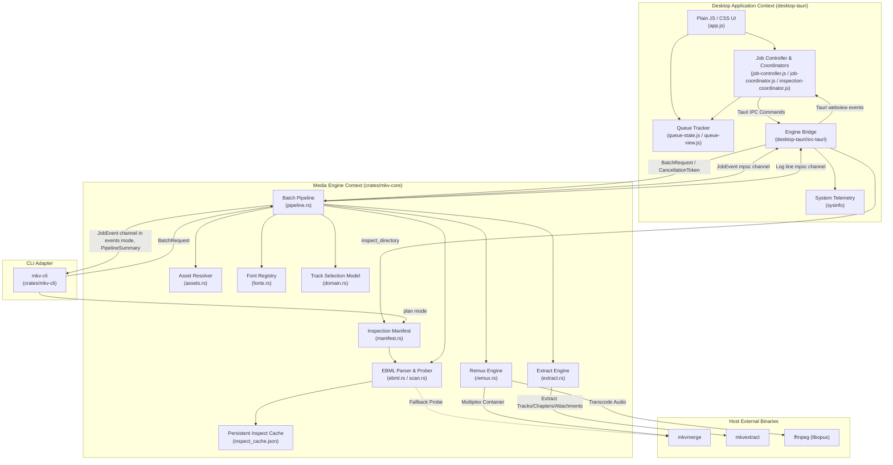
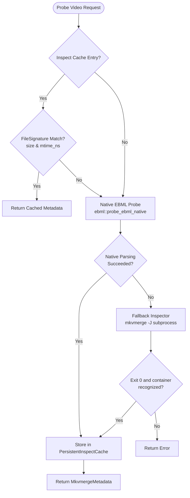
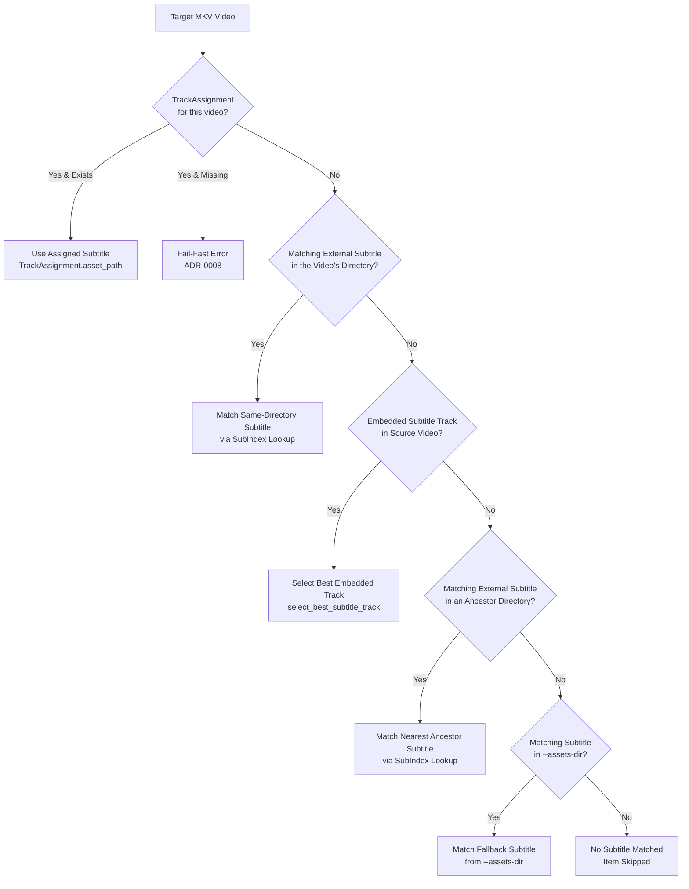
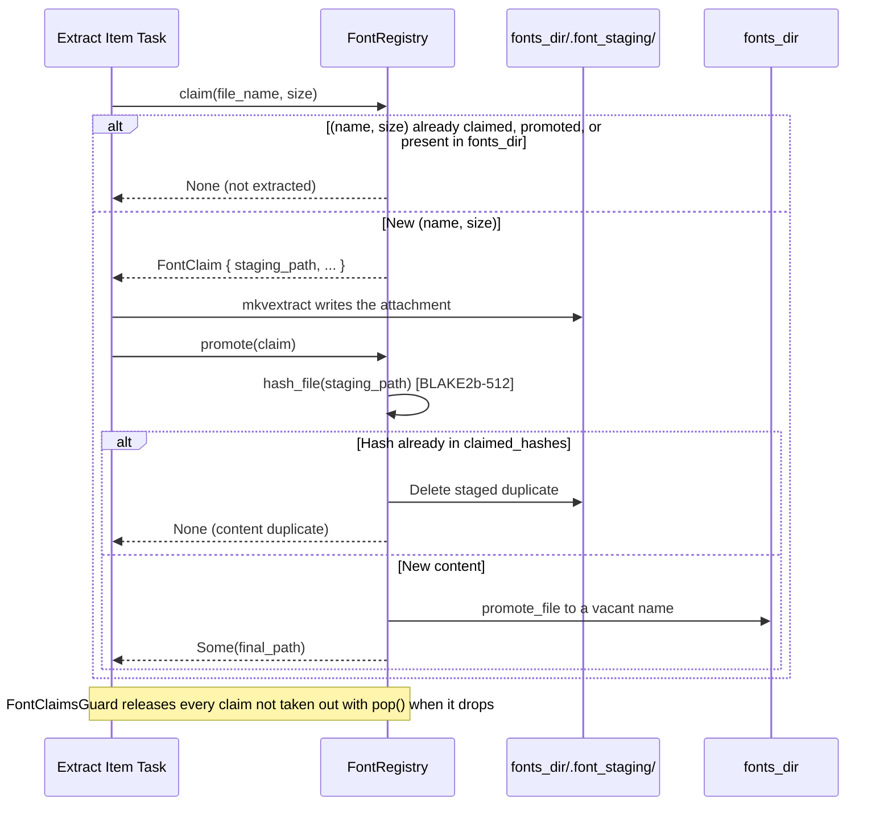
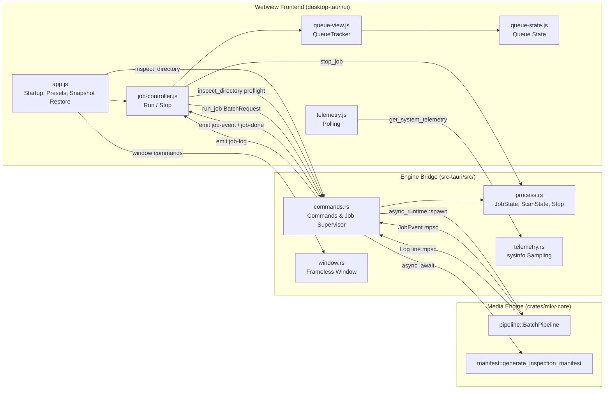
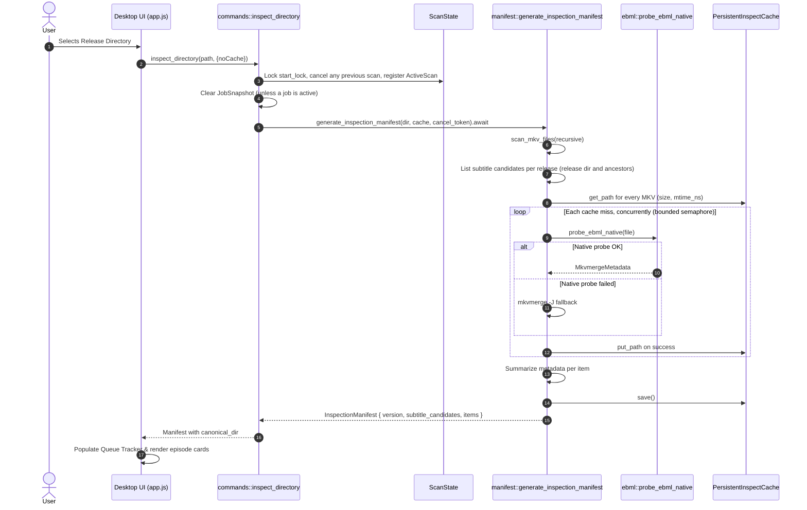
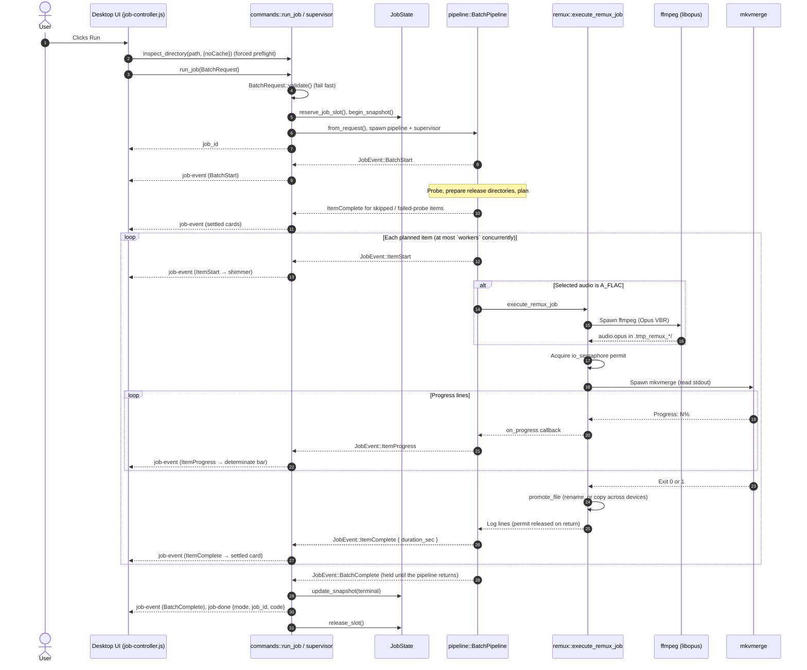

# System Architecture Specification (`mkvanimebatch`)

> **Version**: 1.0.0  
> **Topology**: Rust workspace (engine library + Tauri v2 desktop app + CLI)  
> **Reference Contexts**: [Context Map](./CONTEXT-MAP.md) · [Media Engine](./crates/mkv-core/CONTEXT.md) · [Desktop Application](./desktop-tauri/CONTEXT.md)

---

## 1. Executive Summary

**`mkvanimebatch`** batch-processes anime fansub collections: it remuxes Matroska episodes with the best matching subtitle, chapters, cover, fonts, and a single audio track (FLAC transcoded to Opus), or extracts subtitles, chapters, covers, and fonts from them. Releases are often split across season directories, carry external subtitle revisions next to or above the video, repeat the same fonts in every episode, and need subtitle timing offsets.

The system provides:

1. **Hybrid inspection**: a native Rust EBML parser reads track, attachment, and chapter metadata; `mkvmerge -J` is the fallback when native parsing fails.
2. **Fansub heuristics**: episode identity parsing, audio track ranking (Japanese, then undetermined, then stereo; commentary tracks only as a last resort), and subtitle ranking (Indonesian, then undetermined, then English; ASS above other formats).
3. **Transactional font extraction**: fonts are claimed by `(name, size)`, staged, deduplicated by BLAKE2b-512 content hash, then promoted or released (`claim` → stage → `promote`/`release`).
4. **Two concurrency limits**: `workers` bounds concurrently processed items; the `io_jobs` semaphore bounds the muxing (`mkvmerge`) and extraction (`mkvextract`) phases, so Opus transcoding overlaps with muxing.
5. **Atomic outputs**: work is staged in temporary directories inside the destination and moved into place with `promote_file`, which copies only across device boundaries. Scratch directories are removed when dropped, including on error and cancellation.
6. **One engine, two front-ends**: `crates/mkv-core` runs in-process inside the Tauri v2 desktop app (`desktop-tauri`) and the terminal CLI (`crates/mkv-cli`).

---

## 2. Context Map & Domain Language

The system has two bounded contexts connected by an in-process integration layer.



### Ubiquitous Language & Core Terminology

The vocabulary lives with the context that owns it:

- [Media Engine Context](./crates/mkv-core/CONTEXT.md): release discovery, asset resolution, track scoring, fonts, and the execution model.
- [Desktop Application Context](./desktop-tauri/CONTEXT.md): queue projection, the Engine Bridge, and the desktop coordinators.

A term used by both contexts is defined once, by the context that produces it, and linked from the consumer.

---

## 3. Workspace Topology & Module Organization

The Cargo workspace shares one version (`1.0.0`) and edition 2021:

```
mkvanimebatch/
├── Cargo.toml                       # Workspace root manifest (crates/mkv-core, crates/mkv-cli, desktop-tauri/src-tauri)
├── CONTEXT-MAP.md                   # Context boundaries and relationships
├── AGENTS.md                        # Agent workflow rules, CI gate, agent skills
├── README.md                        # User guide and CLI/GUI reference
├── docs/
│   ├── adr/                         # Architectural Decision Records (0001 - 0015)
│   └── agents/                      # Domain docs, issue tracker, and triage label conventions
├── crates/
│   ├── mkv-core/                    # Engine library
│   │   ├── Cargo.toml
│   │   ├── CONTEXT.md               # Media Engine bounded context
│   │   ├── src/
│   │   │   ├── lib.rs               # Module declarations
│   │   │   ├── domain.rs            # Episode parsing, natural sort, language detection, track scoring, output naming, promote_file
│   │   │   ├── cpu.rs               # Crate-private: physical core count (/proc/cpuinfo on Linux) and transcode thread governor
│   │   │   ├── ebml.rs              # Native EBML/Matroska metadata parser
│   │   │   ├── scan.rs              # MKV and asset discovery, mkvmerge -J fallback probe, PersistentInspectCache
│   │   │   ├── assets.rs            # AssetResolver, SubIndex, ChapterIndex, CoverIndex, release preparation
│   │   │   ├── fonts.rs             # Fonts directory lookup, FontRegistry, FontHashMemo, FontClaimsGuard
│   │   │   ├── manifest.rs          # InspectionManifest generation and metadata summaries
│   │   │   ├── preset.rs            # PresetProfile catalog and lookup
│   │   │   ├── request.rs           # BatchRequest, TrackAssignment, validation, assignments JSON parsing
│   │   │   ├── remux.rs             # Track selection, ffmpeg/mkvmerge argument building, remux execution
│   │   │   ├── extract.rs           # mkvextract invocation for subtitles, chapters, covers, and fonts
│   │   │   └── pipeline.rs          # BatchPipeline, JobEvent and log channels, tokio JoinSet scheduling
│   │   ├── benches/                 # bench_pipeline.rs (BatchRequest::validate throughput, warm-cache remux/extract dry runs)
│   │   └── tests/                   # 11 integration suites: test_assets, test_cross_regex, test_domain, test_extract, test_fonts, test_pipeline, test_pipeline_assignments, test_pipeline_assignment_args, test_real_remux, test_remux, test_scan
│   └── mkv-cli/                     # CLI binary
│       ├── Cargo.toml
│       └── src/
│           └── main.rs              # Argument parsing, executable-name mode default, --plan, --events, signal handling
└── desktop-tauri/                   # Desktop app (Tauri v2 + webview)
    ├── CONTEXT.md                   # Desktop Application bounded context
    ├── src-tauri/
    │   ├── Cargo.toml
    │   ├── tauri.conf.json          # Tauri application configuration
    │   ├── tauri.linux.conf.json    # Linux overrides (transparent window)
    │   ├── capabilities/            # Tauri capability definitions
    │   └── src/
    │       ├── lib.rs               # Tauri builder, command registration, exit handling, Linux environment defaults
    │       ├── main.rs              # Binary entry point
    │       ├── commands.rs          # inspect_directory, run_job, clear_cache, pickers, presets, snapshot; job supervisor
    │       ├── process.rs           # JobState/ScanState, job slot, stop and shutdown, JobSnapshot projection
    │       ├── telemetry.rs         # sysinfo CPU, RAM, and engine process write-rate sampling
    │       └── window.rs            # Frameless window controls, drag/resize, native window theme
    └── ui/                          # Webview frontend (plain ES modules and CSS)
        ├── index.html               # Application shell, views, modals
        ├── style.css                # Layout, cards, light/dark themes, system font stacks
        ├── os-detect.js             # Adds an is-windows/is-mac/is-linux class to <html> (classic script)
        ├── app.js                   # Startup, presets, theme, telemetry gauges, log console, subtitle assignment modal, window controls
        ├── queue-state.js           # Queue state factories, JobEvent reducer, selection and order helpers
        ├── queue-view.js            # QueueTracker: episode card rendering, selection, reordering, heartbeat
        ├── job-controller.js        # BatchRequest from the form, concurrency validation, preflight, run/stop, job event routing
        ├── job-coordinator.js       # Allows one active job across the Remux and Extract views
        ├── inspection-coordinator.js# Shares in-flight inspect_directory calls per (path, noCache)
        ├── telemetry.js             # Polls get_system_telemetry (1 s during a job, 30 s idle, paused while hidden)
        ├── log-classify.js          # Maps log lines to console classes (line-err, line-skip, line-ok, line-warn, line-info, line-done)
        └── *.test.js                # node:test suites for the frontend modules
```

---

## 4. Media Engine (`crates/mkv-core`)

The `mkv-core` crate holds the domain rules and runs the batch pipelines.

### 4.1 Hybrid EBML Probing & Inspection



1. **Native parser (`ebml.rs`)**:
   - Requires an EBML Header (`0x1A45DFA3`) followed by a Segment (`0x18538067`).
   - Scans top-level elements up to the first Cluster, reading `Tracks` (`0x1654AE6B`) and `Attachments` (`0x1941A469`) and noting `Chapters` (`0x1043A770`). Elements placed after the clusters are reached through the `SeekHead` (`0x114D9B74`); a file with clusters but no SeekHead before them fails over to `mkvmerge -J`.
   - Reads track `TrackType` (video, audio, subtitles), `CodecID`, `Language` (falling back to the primary subtag of `LanguageIETF`), `Name`, `PixelWidth`/`PixelHeight`, and audio `Channels` (default 1 when absent). `TrackNumber`, `FlagDefault`, and `FlagForced` are only validated; track IDs are assigned sequentially in file order, as mkvmerge numbers them.
   - Reads attachment `FileName`, `FileMimeType`, and `FileData` size. Chapters are recorded only as present or absent.
   - Fails (and so triggers the fallback) only when the probe returns an error: missing EBML header or Segment, a malformed top-level element, clusters with no SeekHead before them, or no track found. A malformed SeekHead entry or a truncated tail ends the scan without failing. ADR-0013 measured the warm native probe at 0.091 ms.

2. **Fallback inspector (`scan.rs`)**:
   - Runs `mkvmerge -J` with a 30-second timeout and rejects output whose `container.recognized` is `false`.
   - On Windows every child tool (`mkvmerge`, `mkvextract`, `ffmpeg`) is spawned with `CREATE_NO_WINDOW` (`0x08000000`).

3. **Persistent inspection cache (`PersistentInspectCache`)**:
   - Keyed on the canonical file path (Windows `\\?\` prefix stripped) and valid while `FileSignature { size: u64, mtime_ns: u128 }` matches.
   - State is guarded by a `parking_lot::Mutex`.
   - Stored at `inspect_cache.json` under `$LOCALAPPDATA/mkvanimebatch` when `LOCALAPPDATA` is set, else `$HOME/.cache/mkvanimebatch`, else `./.cache/mkvanimebatch`. Writes go to a `NamedTempFile` that is persisted over the cache file. `save()` writes immediately; `save_shared()` skips the write if the previous one was under 500 ms ago.

---

### 4.2 Asset Resolution & Fansub Heuristics

A release's search directories are the input root and every directory down to the video's directory. External subtitles, XML chapters, and covers are indexed from those directories and, when `--assets-dir` is given, from the assets directory (the subdirectory mirroring the release's position when it exists, else the assets root) and its parent as fallback indices.



1. **Resolution precedence (ADR-0004, ADR-0008)**:
   - **Tier 1 (Manual Assignment)**: the user's `TrackAssignment`. A missing target video or asset fails `BatchRequest::validate`; an asset that disappears before planning fails the batch (see §8.1).
   - **Tier 2 (Same-Directory External)**: an external subtitle in the video's own directory with the same episode identity.
   - **Tier 3 (Embedded Track)**: the best embedded subtitle track.
   - **Tier 4 (Nearest Ancestor External)**: an external subtitle in the nearest ancestor directory that has a match.
   - **Tier 5 (Assets Fallback)**: an external subtitle from the `--assets-dir` indices, assets directory before its parent.
   - Source tier beats language score: an adjacent English subtitle beats an embedded Indonesian track, and an embedded Indonesian track beats a parent-directory English subtitle. Within a tier, external candidates rank by nearest directory, category score, dialogue keyword, shorter file name, then index order. An external subtitle matches when its episode type and number are equal and the seasons are equal or either is unknown.
   - A video with no match is skipped. A video whose name has no episode number is skipped unless it has a manual assignment.

2. **Episode identity parsing (`parse_episode`)**:
   - Recognises `S01E02`/`S1E2`, `S01P02` parts, season markers (`Season 1`, standalone `S1`), type qualifiers (`OVA`, `OAD`, `ONA`, `Special`, `SP`), and episode markers (`- 02`, `[02]`, `(02)`, `EP02`, `Episode 2`, `第02話`), with a bare-number fallback. `.[±N.Ns]` offset tags are ignored.
   - Keeps fractional episode numbers (`01.5`, `02.5`) without truncation (ADR-0004).

3. **Subtitle scoring (`score_subtitle_category`)**:
   - Format: only ASS counts as ASS: codec `S_TEXT/ASS` for embedded tracks, the `.ass` extension for external files. Everything else (including SSA and SRT) gets the lower non-ASS score.
   - Language (from the track's `Language`, or for external files detected from the file name):
     - Indonesian (`ind` / `id`) ASS: **12 / 11** | non-ASS: **6 / 5**
     - Undetermined (`und`) ASS: **10** | non-ASS: **4**
     - English (`eng` / `en`) ASS: **9 / 8** | non-ASS: **3 / 2**
     - Other languages ASS: **7** | non-ASS: **1**
   - Dialogue: a track name or file stem containing one of the words `full`, `dialogue`, `dialog`, `main`, `complete`, `indo`, `indonesia`, `indonesian` breaks score ties. Embedded ties then go to the lower track ID.

4. **Audio selection (`select_audio_track`)**:
   - Tracks whose name matches `\b(commentary|comment|audio\s+description|ad|extension)\b` (case-insensitive) are excluded. Only when every track matches is the whole set ranked instead.
   - Scores:
     - **10**: Japanese (`ja`/`jpn` prefix), stereo, dialogue name
     - **9**: Japanese, stereo
     - **8**: Japanese, any other channel count
     - **7**: Undetermined (`und`), stereo, dialogue name
     - **6**: Undetermined, stereo
     - **5**: Undetermined, any other channel count
     - **4**: Any other stereo track
     - **3**: Any other track positioned after the video track
     - **1**: Anything else
   - Ties go to the earlier track in the container (`Reverse(track.pos)`).
   - Only a FLAC (`A_FLAC`) selection is transcoded; any other codec is copied.

5. **Chapter & cover conventions (ADR-0004)**:
   - Chapters: any `.xml` file whose first 4 KiB contain `<Chapters` followed by a space or `>` (case-insensitive) is a chapter file. It matches a video when its file stem parses to the same episode, with a compatible season; no `_chapters` suffix is required. For duplicates with the same episode and season, the file in the nearest directory wins. A chapter file with no episode number is claimed only when it is the release's only such file and exactly one parsed video has neither a matching chapter file nor embedded chapters (`claim_leftover_chapters`); otherwise it stays unclaimed. Claimed and `--assets-dir` chapters apply only to videos without embedded chapters.
   - Covers: directory covers are `cover.<ext>` and `folder.<ext>`. Episode covers are `<name>_cover.<ext>` and `<name>.cover.<ext>` where `<name>` parses to the video's episode, plus an exact adjacent `<video-stem>.<ext>`. A `*_cover` file whose name does not parse to an episode is never a directory cover. The nearest applicable directory wins before cover kind. Within a directory, ranking is episode `_cover` > `.cover` > exact adjacent bare stem > directory `cover` > `folder`. The bare-stem form requires the identical parent directory, so a root bare cover never attaches to a nested same-stem video. Because the fallback index ranks by the assets directory's own layout rather than the video's ancestors, a bare-stem cover inside `--assets-dir` only matches a video in that same directory; use `cover.<ext>`/`folder.<ext>` or the `_cover`/`.cover` forms for cross-directory `--assets-dir` covers. Equal-tier candidates break ties by natural file-name order, then full path. Release-tree covers supersede embedded artwork; `--assets-dir` covers apply only when the source has no cover attachment.

---

### 4.3 Transactional Font Registry & Deduplication (`fonts.rs`)

Episodes of a series usually embed the same fonts. In extract mode, `FontRegistry` makes sure each font is written to the fonts directory once.



1. **Claim**: a claim reserves the sanitized file name and attachment size. Creating a registry seeds the reservations and content hashes of the regular font files already in the fonts directory, so existing fonts are not extracted again.
2. **Stage**: `mkvextract` writes claimed fonts to `.tmp_<token>_<name>` files in `<fonts_dir>/.font_staging/`.
3. **Hash**: `promote` computes a BLAKE2b-512 hash of the staged file. An empty or unreadable file releases the claim. A hash already in `claimed_hashes` drops the staged file but keeps the `(name, size)` reservation, so later episodes skip that attachment. `FontHashMemo` (`font_hash_memo.json` in the cache directory, or `PipelineConfig::font_hash_memo`; disabled by `no_cache`) caches the hashes of existing and promoted fonts by path and `FileSignature`, so seeding does not rehash unchanged files.
4. **Promote**: `promote_file` moves the staged font to `<fonts_dir>/<name>`, or to `<stem>_<hash8><ext>` (plus a counter if needed) when that name is taken.
5. **Release on drop**: `FontClaimsGuard` holds the claims of one extraction. Claims taken out with `pop()` are promoted; any still held when the guard drops (error, cancellation, or panic) are released and their staging files deleted. After the batch each registry removes its staging directory if empty (`cleanup_staging`).
6. **Mode split**: extraction (`extract.rs`) writes new fonts to the fonts directory (`--fonts-dir`, else `fonts` under the resolved output directory). Remux (`remux.rs`) does not extract fonts: it attaches every font file in the release's fonts directory, sorted naturally, and keeps the source's own font attachments only when that directory has none. The remux fonts directory is `--fonts-dir`, else the nearest directory from the video up to the input root whose `fonts` directory (or `font`/`attachments`, ASCII case-insensitive) contains fonts, else the assets directory's, else `<video dir>/fonts`.
7. **Extraction outputs**: each extraction runs one `mkvextract` call into a `.tmp_extract_*` directory, then promotes into the video's directory (or its mirror under `--out-dir`): the best ASS/SSA subtitle as `{stem}_{EpLabel}{ep}_{lang}_track{id}.ass`, chapters as `{stem}_{EpLabel}{ep}_chapters.xml`, and the cover as `{stem}_cover{ext}` (skipped when that file already exists). `{EpLabel}{ep}` is omitted when the file name has no parsable episode.

---

### 4.4 Remux & Transcode Orchestration (`remux.rs`)

1. **Audio transcoding (FLAC to Opus)**:
   - When the selected audio track is `A_FLAC`, `ffmpeg` encodes it to `audio.opus` in the item's scratch directory: `-y -analyzeduration 0 -probesize 1M -v warning -threads <n> -i <video> -map 0:a:<index> -c:a libopus -b:a <bitrate> -vbr on -compression_level <complexity> -application audio <output>` (`-threads` is an input option, so it precedes `-i`).
     - Bitrate: preset or `--bitrate` (default `192k`).
     - Complexity: `0-10` (default `5`; `10` in the Hi-Fi preset). ADR-0013 lowered the default from 10.
     - Threads: without `--ffmpeg-threads`, the governor default `(physical_cores / workers).clamp(1, 4)`.
     - Timeout: 30 minutes (`SUBPROCESS_TIMEOUT`), which also applies to `mkvmerge` and `mkvextract`.
2. **Subtitle synchronization**:
   - External subtitle: `--sync 0:<ms>`, where `<ms>` is the assignment's `offset_ms` when it has one (an explicit `0` means unshifted), else the global `sub_offset` seconds × 1000, rounded.
   - Embedded subtitle: `--sync <track_id>:<ms>` from the global `sub_offset` only.
   - Negative and positive offsets are passed to mkvmerge unchanged.
3. **mkvmerge arguments (`build_mkvmerge_args`)**, writing to a temporary file in the scratch directory:
   - Source file: `--video-tracks <id>`; `--audio-tracks <id>` when the audio is copied, `--no-audio` when it is transcoded; `--subtitle-tracks <id>` for an embedded subtitle, else `--no-subtitles`; `--no-chapters` when an external chapter file is used; `--attachments <ids>` keeps the source cover (when no external cover is used) and the source fonts (when the release has none), else `--no-attachments`.
   - Transcoded audio: the Opus file as a second input with the source track's `--language` and `--track-name`.
   - External subtitle: `--language` (assignment language, else the detected language), `--track-name` (assignment title, else the language label), `--default-track-flag 0:yes`.
   - `--chapters <file>` for an external chapter file.
   - External cover: `--attachment-name cover<ext> --attachment-mime-type <mime> --attach-file <cover>`.
   - Fonts: `--attachment-mime-type <mime> --attach-file <font>` for each font in the fonts directory.
4. **Completion**: exit code 1 (warnings) counts as success. The output must exist and be non-empty; it is then moved to its final path with `promote_file`. By default the output goes to `Output/<stem>.mkv` beside the source; with `--out-dir` it goes to the mirrored directory under the output root. OVA and special episodes get an `OVA<ep>_` / `SP<ep>_` prefix.

---

### 4.5 Batch Pipeline Concurrency & Execution (`pipeline.rs`)

`BatchPipeline` runs one batch across a whole release tree. Remux mode:

```mermaid
flowchart TD
    Req["BatchRequest\n(validated by the caller: BatchRequest::validate)"] --> Config["BatchPipeline::from_request\ninto_pipeline_config"]
    Config --> Discover["scan_mkv_files (recursive, natural order,\nskips Output and fonts/font/attachments dirs)"]
    Discover --> Select["apply_selected_items\nselection order, unmatched selection fails"]
    Select --> Targets["validate_assignment_targets\neach target matches exactly one video"]
    Targets --> Start["Emit JobEvent::BatchStart"]
    Start --> Probe["Probe all videos concurrently\n(workers * 2).clamp(2, 16) semaphore"]
    Probe --> Prep["Per release directory:\nprepare_release_directory, scan_fonts,\nclaim_leftover_chapters"]
    Prep --> Plan["Plan in batch order:\nemit skipped / error / planned outcomes,\ncollect PlannedJobs"]
    Plan --> Schedule["run_items: tokio JoinSet\nat most `workers` tasks in flight"]

    subgraph ItemTask["Per-item task"]
        direction TB
        StartTimer["Instant::now, emit JobEvent::ItemStart"] --> Transcode["ffmpeg Opus transcode\nwhen audio is A_FLAC"]
        Transcode --> AcquireIO["Acquire I/O permit\nio_semaphore.acquire"]
        AcquireIO --> Mux["mkvmerge remux\nprogress → ItemProgress"]
        Mux --> Promote["promote_file to the final path"]
        Promote --> ReleaseIO["Drop I/O permit"]
        ReleaseIO --> EmitDone["Emit JobEvent::ItemComplete\nwith duration_sec"]
    end

    Schedule --> ItemTask
    ItemTask --> BatchDone["Emit JobEvent::BatchComplete"]
```



Extract mode skips probing and planning up front: each item task probes its video, acquires an I/O permit, and runs one `mkvextract` call plus promotions while holding it.

1. **Two concurrency limits (ADR-0011)**:
   - **`workers`**: `run_items` keeps at most `workers` item tasks in its `JoinSet`. The default is the physical core count clamped to 1–16.
   - **`io_jobs`**: a semaphore bounds the item phases that write heavily to disk: `mkvmerge` plus promotion in remux, the whole `mkvextract` run plus promotions in extract. Transcoding runs before the permit is requested, so it overlaps with other items' muxing. The default is 2; `0` means the same limit as `workers`.
2. **Global work queue (ADR-0011)**:
   - Planned jobs from every release directory form one queue in batch order, so workers do not idle at directory boundaries. Asset resolution stays per directory.
3. **Cooperative cancellation (`CancellationToken`)**:
   - Checked while probing, after probing, before planning each item, and before each task launch. Each item's work future races the token in a `tokio::select!`, so a stop drops the in-flight work at its next await point.
   - Child processes are spawned with `kill_on_drop(true)`, and scratch directories are `TempDir`s, so dropping the work kills the tools and removes staged files. After a stop, `run_items` aborts the remaining tasks and settles every in-flight and unstarted item as `cancelled`.
4. **Item duration (ADR-0009)**:
   - The engine takes `Instant::now()` when it starts an item and puts `elapsed().as_secs_f64()` in `JobEvent::ItemComplete { duration_sec: Some(..) }` for every started item, whether it completed, failed, or was cancelled.
5. **Panicking items**: a task that panics settles its item as `error` (`worker panicked: ...`); the rest of the batch continues.

---

## 5. Desktop Application Architecture (`desktop-tauri`)

The desktop app pairs a Rust host (Tauri v2) with a webview frontend in plain JavaScript and CSS.



### 5.1 In-Process Engine Bridge (`commands.rs`, `process.rs`)

The engine runs inside the desktop process (ADR-0007, ADR-0008). Registered Tauri commands: `inspect_directory`, `run_job`, `stop_job`, `clear_cache`, `pick_directory`, `pick_subtitle_file`, `get_preset_profiles`, `get_job_snapshot`, `get_system_telemetry`, `close_window`, and the window controls `minimize_window`, `toggle_maximize`, `is_maximized`, `start_drag`, `start_resize`, `set_window_theme`. Events emitted to the webview: `job-event` (a `JobEvent` plus `mode` and `job_id`), `job-log` (a batch of log lines), `job-done` (`{mode, job_id, code}`, code `0` completed, `-1` cancelled, `1` otherwise), and `cleanup-error`.

1. **In-memory channels**: the engine sends `JobEvent`s and log lines over Tokio mpsc channels. The supervisor forwards log lines in batches of up to 25 lines or every 25 ms.
2. **Job slot & panic isolation**:
   - `JobState` holds at most one `JobSlot`; `run_job` fails while a job is running or stopping, and after shutdown has begun.
   - `run_job` validates the request, then spawns the pipeline with `tauri::async_runtime::spawn` and a supervisor task. The supervisor holds back the engine's `BatchComplete` until the pipeline future returns, then publishes one terminal `job-event` and `job-done` and releases the slot. A pipeline error or panic caught at the `JoinHandle` becomes a failed terminal event (with `error` or `panic`) instead of crashing the app. This depends on the release profile unwinding on panic; the root `Cargo.toml` must never set `panic = "abort"`.
3. **Two-phase stop (ADR-0007)** (`stop_job`, and `close_window`/app exit for every owned job and scan):
   - **Phase 1 (cooperative)**: cancels the job's `CancellationToken` and waits up to 2 seconds (`STOP_TIMEOUT`) for the supervisor to release the slot.
   - **Phase 2 (abort)**: if the slot is still held, aborts only the pipeline task (`slot.pipeline_abort.abort()`) and waits up to 1 more second. The supervisor survives to publish the cancelled terminal event and `job-done`, then releases the slot.
   - `close_window` and the `ExitRequested` handler first stop new jobs and scans from starting (`begin_shutdown`), then run both stops (`cleanup_owned_processes`). If cleanup fails, starts are allowed again (`cancel_shutdown`) and the error is returned, or emitted as `cleanup-error`.
4. **`JobSnapshot` projection (ADR-0008, ADR-0009)**:
   - The supervisor reduces every forwarded `JobEvent` into an in-memory `JobSnapshot` (status, input directory, item order, per-item status, progress, reason, error, and duration).
   - On startup the webview calls `get_job_snapshot()` and rebuilds the queue from it, so a reload keeps the running or finished batch, its outcomes, and its durations. Starting a new inspection clears the snapshot unless a job is active.
5. **Canonical directory identity**:
   - Every directory identity crossing the bridge into the Queue Tracker is the **display form** of the canonical path: a Windows verbatim (`\\?\`) prefix is stripped and `\\?\UNC\` is rewritten to `\\` (`commands.rs`, `display_canonical_path`).
   - This applies to the Inspection Manifest's `canonical_dir`, the Job Snapshot's `input_dir`, and `JobEvent::BatchStart.input_dir`. The engine still receives and uses the real `PathBuf` for filesystem work; only the projected form is normalized, in the bridge.
   - The three must agree because Queue Tracker directory identity is a string comparison. A mismatch, for example a raw verbatim `BatchStart.input_dir` against a stripped `canonical_dir`, silently drops Queue Selection and Active Batch ordering on the next same-directory rescan, because a release directory whose name ends in `.` or a space normalizes differently in each form.
6. **Linux desktop environment defaults (`lib.rs`, ADR-0015)**:
   - Defaults `GDK_BACKEND=x11,wayland` to avoid `EGL_BAD_PARAMETER` aborts under native Wayland.
   - Inside an AppImage (`APPIMAGE` or `APPDIR` set), preloads the host `libwayland-client.so.0` via `LD_PRELOAD` to avoid ABI conflicts between the bundled library and host Mesa drivers, and disables WebKitGTK DMABUF rendering (`WEBKIT_DISABLE_DMABUF_RENDERER=1`) to avoid the Mesa EGL segfault on exit (`SkiaGLContext` teardown).
   - The DMABUF workaround is scoped to AppImage deliberately and must not be widened to Native Packages (RPM/DEB). On those installs running WebKitGTK 2.54+, disabling DMABUF drops Skia to CPU shared-memory rendering; the Linux window is `transparent: true` (`tauri.linux.conf.json`), so only pointer-damaged regions recomposite and the rest of the window shows the desktop through it. Native Packages therefore keep DMABUF enabled. See [ADR-0015](docs/adr/0015-per-package-webkitgtk-dmabuf-renderer-scoping.md) for the full rationale.
   - `init_linux_env()` only ever *defaults* `GDK_BACKEND` and `WEBKIT_DISABLE_DMABUF_RENDERER`; both are `is_none()`-guarded, so an operator who exported `WEBKIT_DISABLE_DMABUF_RENDERER=1` to work around the original shutdown segfault keeps that override and so keeps the rendering bug. The fix for that operator is to unset the variable, not to widen the default. The `libwayland-client` preload is the one exception, and it behaves differently in both directions: it is guarded by a `contains()` check, so it *defers* to an operator who has already preloaded a `libwayland-client`, and *prepends* to whatever unrelated value is already there rather than replacing it.

---

### 5.2 System Telemetry (`telemetry.rs`, `telemetry.js`)

The webview polls `get_system_telemetry` every second while a job is active and every 30 seconds otherwise, skipping ticks while a request is in flight and pausing while the page is hidden.

1. **Per-poll sampling** (`sysinfo::System`): overall CPU percentage, RAM used/total, and `io_mb_s`, the bytes written since the previous poll by the app process and its direct child `mkvmerge`, `mkvextract`, and `ffmpeg` processes (`is_engine_process`), divided by the time between polls.
2. **Idle cost**: when no job or scan is active, only the app's own process is refreshed (`ProcessesToUpdate::Some(&[self_pid])`); otherwise all processes are refreshed to find the children.

---

### 5.3 Presentation & Queue State (`ui/`)

The frontend is plain ES modules with no framework.

1. **Queue state (`queue-state.js`)**:
   - `createQueueState(manifest)` creates item records keyed by `item.id`.
   - `reduceQueueEvent(state, event)` updates the owned item records and counters in place ($O(1)$ per event) and returns the same state object.
   - Order and selection helpers back queue reordering (`▲` / `▼`) and selective execution (`selected_items`).
2. **Card rendering (`queue-view.js`)**:
   - `QueueTracker.renderCardsIncrementally` creates every card in `requestAnimationFrame` batches, each running until a best-effort ~8 ms deadline, so large manifests do not block the main thread.
   - Events update mounted cards synchronously; a card created later renders from the item's current reducer state. Log lines are queued and flushed once per animation frame, keeping the last 2000 lines.
3. **Card progress (ADR-0009)**:
   - **Indeterminate shimmer**: from `ItemStart` until the item reports numeric progress (probing, transcoding).
   - **Determinate bar**: filled from `ItemProgress.progress`, parsed from `mkvmerge`/`mkvextract` `Progress: N%` output.
   - **Terminal state**: `ItemComplete` fills the bar to 100% with the completed, skipped, error, cancelled, or planned styling.
4. **Presentation heartbeat (ADR-0009)**:
   - One 1 Hz timer in `QueueTracker` updates the elapsed time of every processing card, and stops when no item is processing.
5. **Subtitle assignment modal (ADR-0011, ADR-0012)**:
   - Per remux item: choose a subtitle from the manifest's `subtitle_candidates` for the release, or a custom path (browse via `pick_subtitle_file`, an `rfd` native dialog); set the language (`ind`, `eng`, `jpn`, or a custom code), track title, and offset in milliseconds (`offset_ms`). The resulting `TrackAssignment` is sent in `BatchRequest.assignments` and applied to the `mkvmerge` arguments (§4.4).
6. **Theme**: follows `prefers-color-scheme` live until the user toggles the theme; the choice is then stored in `localStorage` (`mkv-theme`) and pinned on the native window via `set_window_theme`.

---

## 6. CLI Adapter (`crates/mkv-cli`)

`mkv-cli` runs the same engine from a terminal.

1. **Executable-name mode default**:
   - When the executable is named `mkv-extract` (case-insensitive, optional `.exe`), the default mode is `PipelineMode::Extract`; otherwise `PipelineMode::Remux`. `--extract` / `--remux` override it (the last one wins). Cargo builds only `mkv-cli`; the `mkv-extract` name comes from renaming or linking the binary.
2. **Execution modes**:
   - **Run**: executes the batch, then prints the summary log lines and a totals line (`Finished. Processed N file(s) ...`).
   - **Preflight planning (`--plan`)**: prints the pretty-printed `InspectionManifest` JSON and exits without writing media.
   - **NDJSON stream (`--events`)**: prints each `JobEvent` as `@event: <json>` on stdout and suppresses the summary output.
   - **`--clear-cache`**: clears the inspection cache and exits.
3. **Arguments**:
   - Maps flags to `BatchRequest`: `--input-dir`, `--out-dir`, `--fonts-dir`, `--assets-dir`, `--preset`, `--bitrate`, `--complexity`, `--sub-offset`, `--workers` (default: physical cores clamped 1–16), `--io-jobs`, `--ffmpeg-threads` (`auto` = governor default), `--assignments`, `--selected-item`, `--selected-items`, `--dry-run`, `--no-cache`, plus `--plan`, `--events`, `--clear-cache`, `--extract` / `--remux`, `-h`/`--help`. Any other argument fails with `Unknown argument: <arg>`.
   - `--assignments <FILE>` is read with `parse_assignments_json`: a `TrackAssignment` array, `{"assignments": [...] | {video: asset}}`, or a flat `{video: asset}` map (maps become subtitle assignments).
   - Selection: `--selected-item <PATH>` (repeatable, literal, commas kept) and `--selected-items <LIST>` (repeatable, comma-separated, whitespace trimmed, empty segments dropped); both require `--input-dir`. Paths are normalized relative to `input_dir`, with a working-directory fallback, and anything resolving outside `input_dir` is rejected. In `--plan` mode, `InspectionManifest::select_items` fails if a selection names no discovered MKV, then keeps the selected items in selection order.
   - Validation: `--preset`, `--bitrate` (positive integer with an optional `k` or `M` suffix), and numeric parsing are checked while parsing; ranges (`workers` 1–64, `io_jobs` 0–64, `ffmpeg_threads` 1–32, `complexity` 0–10) and paths are checked by `BatchRequest::validate()` before anything runs.
4. **Exit codes**: `0` on success; `1` on argument or validation errors, when any item failed, or on a fatal pipeline error; `130` when cancelled by SIGINT (or SIGTERM on Unix).

---

## 7. End-to-End Execution Lifecycles

### 7.1 Preflight Inspection & Manifest Generation



---

### 7.2 Batch Remux Execution



---

## 8. Cross-Cutting Concerns

### 8.1 Safety, Reliability & Error Recovery

1. **Atomic file promotion (`promote_file`)**:
   - Outputs are staged in temporary directories created inside the destination: `.tmp_remux_*` and `.tmp_extract_*` (via `tempdir_in`) and `<fonts_dir>/.font_staging/`.
   - Promotion is a filesystem rename (`fs::rename`).
   - If the rename fails and the destination exists (Windows `rename` refuses to replace), the destination is moved to a backup beside it whose extension is replaced by `bak.<token>` — `Path::with_extension` drops the original, so `Ep01.mkv` becomes `Ep01.bak.<token>`. The staged file is then renamed into place and the backup is removed; if that rename fails, the backup is renamed back.
   - If the rename crosses devices (a typed `CrossesDevices` kind, `EXDEV`/18 off Windows, `ERROR_NOT_SAME_DEVICE`/17 on Windows), the file is copied to a temporary sibling in the destination directory and then renamed over the target.
   - **That copy is reached only for a device boundary** ([ADR-0013 amendment 2](./docs/adr/0013-asynchronous-probing-and-transcode-governance-performance-overhaul.md#amendment-2--2026-09-28-spawn_blocking-scope)). Any other rename failure (missing source, locked destination, permissions) returns the rename error rather than duplicating a multi-gigabyte payload to fail the same way. `promote_file` is synchronous throughout; promotion is not offloaded to Tokio's blocking pool, which would let a cancelled item detach a still-running copy.
2. **Fail-fast input validation (`BatchRequest::validate`)**:
   - Checks that the input, fonts, and assets directories exist and that the output path is not a file.
   - Rejects assignment targets and `selected_items` that are absolute, drive-prefixed, contain `..`, are not `.mkv`, or do not exist; rejects relative asset paths containing `..`, duplicate targets or selections, non-subtitle assignments, missing assets, and assignments whose target is not selected.
   - Checks `workers`, `io_jobs`, `ffmpeg_threads`, `complexity`, bitrate format, and preset before the desktop host reserves the job slot or the CLI starts the pipeline.
   - **Two distinct failure points** ([ADR-0008](./docs/adr/0008-typed-engine-bridge-and-track-assignment-model.md#amendment--2026-09-26)). A validation failure raised **before** `BatchStart` (a selection or an assignment target that matches no discovered item) settles **no** items and emits **no** `BatchComplete`: the run returns an error, writes no media, and the Engine Bridge supervisor settles the job exactly once as failed with an empty snapshot. A planning failure raised **after** `BatchStart` (an assignment whose asset disappeared between validation and resolution) settles the affected item and every remaining queued item as `error` with distinct reasons, followed by exactly one failed `BatchComplete`. Both fail closed; only the second produces per-item outcomes.
3. **Panic containment**:
   - A panic inside an item task settles that item as `error` and the batch continues (§4.5). A panic in the pipeline future itself is caught by the desktop supervisor at the `JoinHandle` (§5.1). Both need unwinding panics: the release profile in the root `Cargo.toml` must never set `panic = "abort"`.

### 8.2 Performance Design

| Concern | Mechanism |
| :--- | :--- |
| **Media probing** | Native EBML parser that stops at the first Cluster and spawns no process; `mkvmerge -J` only when it fails. ADR-0013 measured 0.091 ms per warm native probe. |
| **Inspection caching** | Persistent cache keyed on canonical path and validated by size + `mtime_ns`; unchanged files are not probed again. |
| **Font extraction** | `(name, size)` claims skip re-extraction; BLAKE2b-512 hashes drop content duplicates; `FontHashMemo` avoids rehashing unchanged fonts when seeding (ADR-0013: 364 ms cold → 2.1 ms warm). |
| **Disk contention** | `io_semaphore` bounds concurrent `mkvmerge`/`mkvextract` phases (`io_jobs`, default 2). |
| **Transcode oversubscription** | Default ffmpeg threads per job `(physical_cores / workers).clamp(1, 4)`; default complexity 5 (ADR-0013 reports ~40% less transcode CPU than 10). |
| **UI responsiveness** | In-process channels; host log batching (25 lines / 25 ms); cards created in ~8 ms `requestAnimationFrame` batches; one log flush per animation frame; one 1 Hz heartbeat instead of per-card timers. |

---

## 9. Architectural Decision Records (ADR) Traceability Matrix

| ADR | Title | Core Architectural Impact | Primary Code Location |
| :---: | :--- | :--- | :--- |
| [**0001**](docs/adr/0001-sidecar-contract-and-structured-planning.md) | Sidecar Contract and Structured Planning | Established the manifest v2 schema and structured lifecycle events. Implemented. | `manifest.rs`, `pipeline.rs` |
| [**0002**](docs/adr/0002-unified-asset-resolver-and-batch-runner.md) | Asset Resolver and Runner Architecture | Consolidated asset discovery into `AssetResolver`; separated remux and extract runners. Implemented. | `assets.rs`, `remux.rs`, `extract.rs` |
| [**0003**](docs/adr/0003-transactional-font-extraction.md) | Transactional Font Extraction | Two-phase claim/promote font management with BLAKE2b deduplication. Implemented. | `fonts.rs` |
| [**0004**](docs/adr/0004-resolution-precedence-and-conventions.md) | Resolution Precedence and Conventions | Subtitle precedence ladder (Manual → Same-Directory → Embedded → Ancestor → Fallback), cover ranking rules, fractional episode passthrough. Includes the [2026-09-24 amendment](docs/adr/0004-resolution-precedence-and-conventions.md#amendment--2026-09-24) (embedded-before-ancestor subtitle ordering, cover ranking). | `assets.rs`, `domain.rs` |
| [**0005**](docs/adr/0005-rust-engine-migration-and-workspace-topology.md) | Rust Media Engine Migration | Root workspace topology split into Media Engine and Desktop contexts. Implemented. | `Cargo.toml`, `CONTEXT-MAP.md` |
| [**0006**](docs/adr/0006-hybrid-ebml-probing-and-channel-streaming.md) | Hybrid EBML Probing & Channel Streaming | Native EBML parser with `mkvmerge -J` fallback; Tokio mpsc event channels. Implemented. | `ebml.rs`, `scan.rs`, `pipeline.rs` |
| [**0007**](docs/adr/0007-in-process-engine-bridge.md) | In-Process Engine Bridge | Retired subprocess sidecars; Tauri calls `mkv-core` directly with panic isolation and two-phase stop. Implemented. | `commands.rs`, `process.rs` |
| [**0008**](docs/adr/0008-typed-engine-bridge-and-track-assignment-model.md) | Typed Engine Bridge & Track Assignments | Typed `BatchRequest`, fail-fast preflight validation, and `JobSnapshot` projection. Includes the [2026-09-24](docs/adr/0008-typed-engine-bridge-and-track-assignment-model.md#amendment--2026-09-24) and [2026-09-26](docs/adr/0008-typed-engine-bridge-and-track-assignment-model.md#amendment--2026-09-26) amendments (fail-closed resolution, the two preflight failure points, active batch restore across reloads, removal of `keep_fonts`). | `request.rs`, `preset.rs`, `process.rs` |
| [**0009**](docs/adr/0009-streaming-card-progress-and-item-duration-model.md) | Streaming Card Progress & Item Duration | Engine-owned `duration_sec`, indeterminate-to-determinate card progress, 1 Hz presentation heartbeat. Implemented. | `pipeline.rs`, `queue-state.js`, `queue-view.js` |
| [**0010**](docs/adr/0010-mainline-rust-cutover-and-python-decommissioning.md) | Mainline Rust Engine Cutover | Removed the Python codebase; unified 1.0.0 versioning and CI/release status gates. Implemented. | Root `Cargo.toml`, `.github/workflows/ci.yml`, `.github/workflows/release.yml` |
| [**0011**](docs/adr/0011-selected-items-queue-and-concurrency-pipelining.md) | Selected Items Queue & Concurrency Pipelining | Global Tokio JoinSet, I/O semaphore, parallel probing, per-item track assignment modal. Implemented. | `pipeline.rs`, `request.rs`, `app.js` |
| [**0012**](docs/adr/0012-track-assignment-override-execution-and-seam-unification.md) | Track Assignment Override Execution and Seam Unification | Full `TrackAssignment` (offset, language, title) applied to mkvmerge arguments; `sub_assignments` flattening removed. Includes the [2026-09-26 amendment](docs/adr/0012-track-assignment-override-execution-and-seam-unification.md#amendment--2026-09-26) (offset overrides rather than adds, explicit zero means unshifted, milliseconds throughout). The override rule and explicit-zero guard are implemented; the millisecond normalization and the GUI explicit-zero change are pending ([2026-09-28 amendment](docs/adr/0012-track-assignment-override-execution-and-seam-unification.md#amendment--2026-09-28), issue #19). | `pipeline.rs`, `remux.rs`, `mkv-cli` |
| [**0013**](docs/adr/0013-asynchronous-probing-and-transcode-governance-performance-overhaul.md) | Asynchronous Probing and Transcode Governance Performance Overhaul | Asynchronous mkvmerge fallback probing, transcode thread governor, default complexity 5, font seeding outside the registry lock, cache serialization without intermediate copies, and `promote_file`'s copy fallback limited to device boundaries ([2026-09-28 amendment 2](docs/adr/0013-asynchronous-probing-and-transcode-governance-performance-overhaul.md#amendment-2--2026-09-28-spawn_blocking-scope), [amendment 3](docs/adr/0013-asynchronous-probing-and-transcode-governance-performance-overhaul.md#amendment-3--2026-09-28-traversal-path-contract), [amendment 4](docs/adr/0013-asynchronous-probing-and-transcode-governance-performance-overhaul.md#amendment-4--2026-09-28-current-state-corrections), [amendment 5](docs/adr/0013-asynchronous-probing-and-transcode-governance-performance-overhaul.md#amendment-5--2026-09-28-traversal-path-spelling-reversed): scanned paths keep the caller's spelling). Implemented. | `scan.rs`, `request.rs`, `fonts.rs`, `pipeline.rs`, `domain.rs` |
| [**0014**](docs/adr/0014-cli-selected-items-execution-and-manifest-filtering.md) | CLI Selected Items Execution and Manifest Filtering | `--selected-item` and `--selected-items`, path normalization with working-directory fallback, and `--plan` manifest selection (`InspectionManifest::select_items`). Implemented. | `mkv-cli`, `manifest.rs`, `pipeline.rs` |
| [**0015**](docs/adr/0015-per-package-webkitgtk-dmabuf-renderer-scoping.md) | Per-Package WebKitGTK DMABUF Renderer Scoping | `WEBKIT_DISABLE_DMABUF_RENDERER` scoped to AppImage via the `APPIMAGE`/`APPDIR` markers, so Native Packages keep hardware-accelerated damage tracking on transparent windows. Accepted. | `lib.rs` |

---

## 10. Verification & Quality Gates

Local work and GitHub Actions run the same checks:

```bash
# 1. Rust formatting & lint
cargo fmt --all -- --check
cargo clippy --workspace --all-targets -- -D warnings

# 2. Rust unit and integration tests (mkv-core, mkv-cli, desktop-tauri)
cargo test --workspace

# 3. Frontend syntax check and node:test suites
node --check desktop-tauri/ui/app.js
node --test desktop-tauri/ui/*.test.js
```

CI (`.github/workflows/ci.yml`) runs the Rust checks on Ubuntu 24.04 and Windows, the UI tests, and `cargo audit`. The `mkv-core` integration suite `test_real_remux` drives real FFmpeg/MKVToolNix binaries. Developer-local `cargo test` runs skip it when the tools are absent; CI and release verification set `MKV_REQUIRE_MEDIA_TOOLS=1` on the Ubuntu runner, which makes a missing `ffmpeg`, `mkvmerge`, or `mkvextract` a hard failure.

Releases (`.github/workflows/release.yml`) build only after the `ci-status` gate, which requires the `workspace-checks` job (including the non-skipping real-media regression) and the `ui-tests` job to pass.
