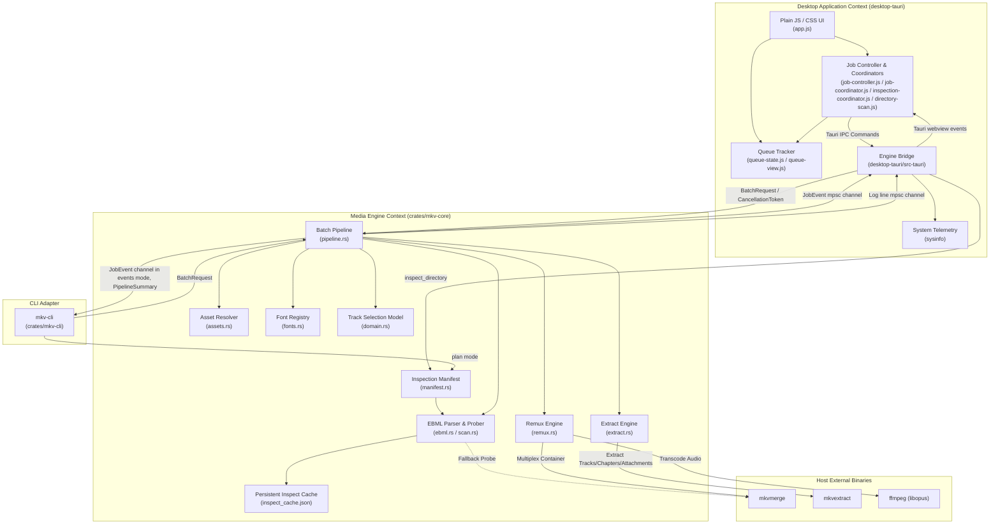
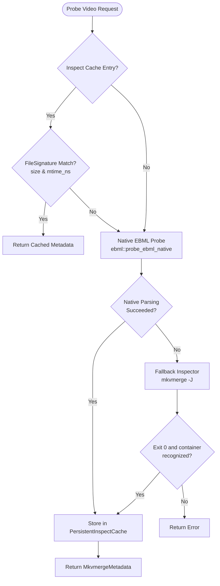
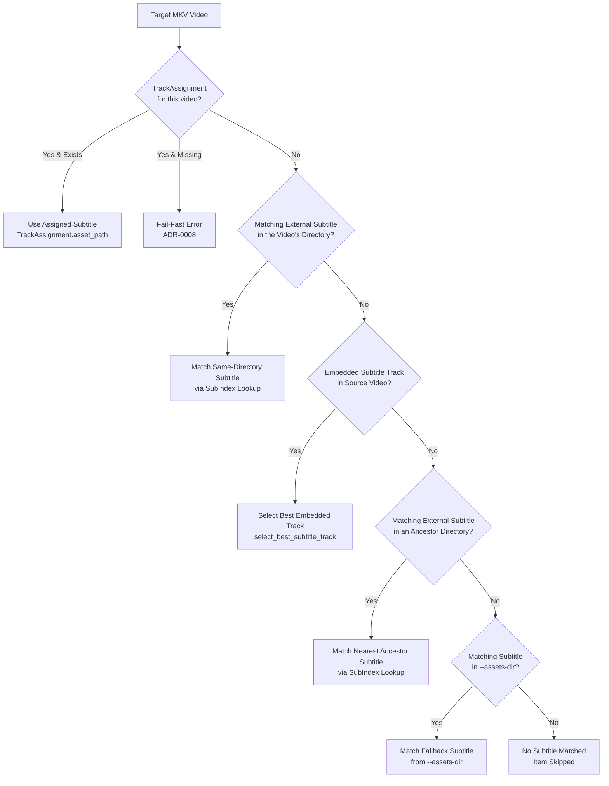
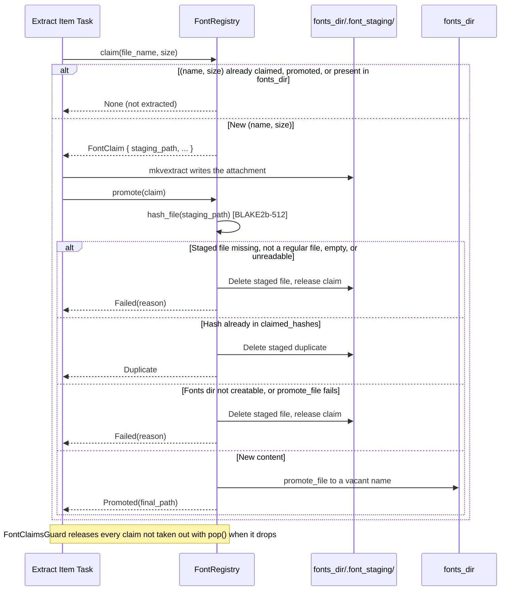
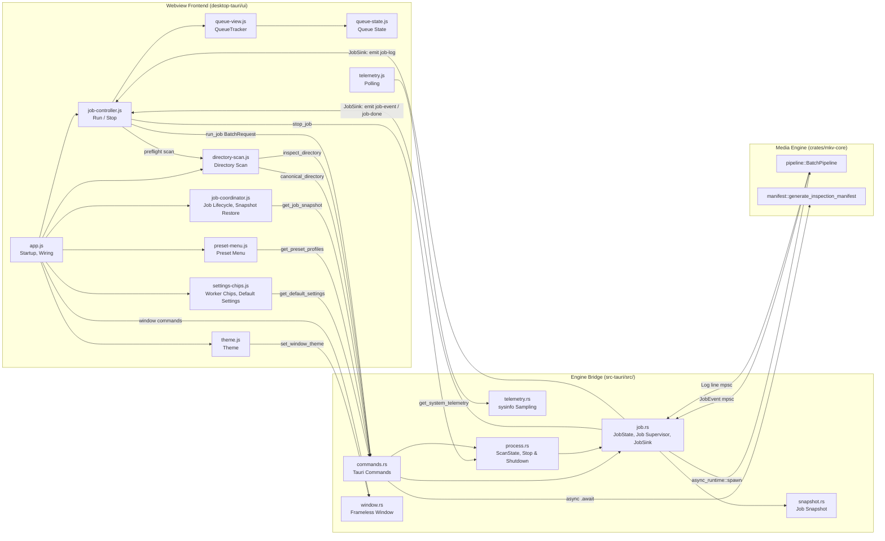
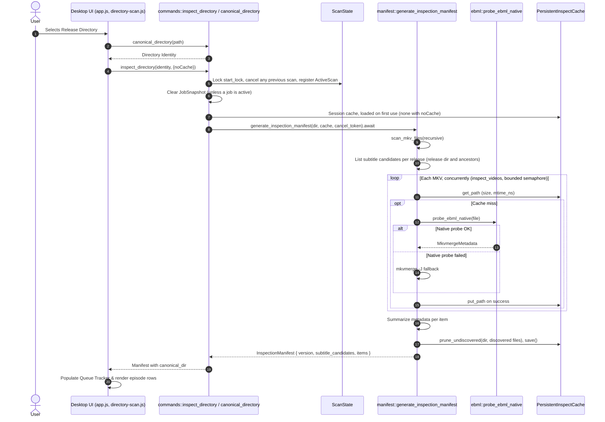

# System Architecture Specification (`mkvanimebatch`)

> **Version**: 1.0.1  
> **Topology**: Rust workspace (engine library + Tauri v2 desktop app + CLI)  
> **Reference Contexts**: [Context Map](./CONTEXT-MAP.md) · [Media Engine](./crates/mkv-core/CONTEXT.md) · [Desktop Application](./desktop-tauri/CONTEXT.md)

---

## 1. Executive Summary

**`mkvanimebatch`** batch-processes anime fansub collections: it remuxes Matroska episodes with the best matching subtitle, chapters, cover, fonts, and a single audio track (FLAC transcoded to Opus), or extracts subtitles, chapters, covers, and fonts from them. Releases are often split across season directories, carry external subtitle revisions next to or above the video, repeat the same fonts in every episode, and need subtitle timing offsets.

The system provides:

1. **Hybrid inspection**: a native Rust EBML parser reads track, attachment, and chapter metadata; `mkvmerge -J` is the fallback when native parsing fails.
2. **Fansub heuristics**: episode identity parsing, audio track ranking (Japanese, then undetermined, then stereo; commentary tracks only as a last resort), and subtitle ranking (Indonesian, then undetermined, then English; ASS above other formats).
3. **Transactional font extraction**: fonts are claimed by `(name, size)`, staged, deduplicated by BLAKE2b-512 content hash, then promoted or released (`claim` → stage → `promote`/`release`).
4. **Two concurrency limits**: `workers` bounds concurrently processed items; the `io_jobs` semaphore bounds the muxing (`mkvmerge`) and extraction (`mkvextract`) phases, so Opus transcoding overlaps with muxing.
5. **Atomic outputs**: work is staged in temporary directories inside the destination and moved into place with `promote_file`, which copies only across device boundaries. Scratch directories are removed when dropped, including on error and cancellation.
6. **One engine, two front-ends**: `crates/mkv-core` runs in-process inside the Tauri v2 desktop app (`desktop-tauri`) and the terminal CLI (`crates/mkv-cli`).

---

## 2. Context Map & Domain Language

The system has two bounded contexts connected by an in-process integration layer.



### Ubiquitous Language & Core Terminology

The vocabulary lives with the context that owns it:

- [Media Engine Context](./crates/mkv-core/CONTEXT.md): release discovery, asset resolution, track scoring, fonts, and the execution model.
- [Desktop Application Context](./desktop-tauri/CONTEXT.md): queue projection, the Engine Bridge, and the desktop coordinators.

A term used by both contexts is defined once, by the context that produces it, and linked from the consumer.

---

## 3. Workspace Topology & Module Organization

The Cargo workspace shares one version and edition 2021:

```
mkvanimebatch/
├── Cargo.toml                       # Workspace root manifest (crates/mkv-core, crates/mkv-cli, desktop-tauri/src-tauri)
├── CONTEXT-MAP.md                   # Context boundaries and relationships
├── AGENTS.md                        # Agent workflow rules, CI gate, agent skills
├── README.md                        # User guide and CLI/GUI reference
├── docs/
│   ├── adr/                         # Architectural Decision Records (0001 - 0016)
│   └── agents/                      # Domain docs, issue tracker, and triage label conventions
├── crates/
│   ├── mkv-core/                    # Engine library
│   │   ├── Cargo.toml
│   │   ├── CONTEXT.md               # Media Engine bounded context
│   │   ├── src/
│   │   │   ├── lib.rs               # Module declarations
│   │   │   ├── domain.rs            # Episode parsing, natural sort, language detection, track scoring, output naming, promote_file
│   │   │   ├── cpu.rs               # Crate-private: physical core count (/proc/cpuinfo on Linux, capped at available_parallelism) and transcode thread governor
│   │   │   ├── ebml.rs              # Native EBML/Matroska metadata parser
│   │   │   ├── scan.rs              # MKV and asset discovery, mkvmerge -J fallback probe, PersistentInspectCache
│   │   │   ├── assets.rs            # AssetResolver, SubIndex, ChapterIndex, CoverIndex, ReleasePreparer (release preparation)
│   │   │   ├── fonts.rs             # Fonts directory lookup, FontRegistry, FontHashMemo, FontClaimsGuard
│   │   │   ├── inspect.rs           # Crate-private: inspect_videos, the one cancellable bulk probe fan-out behind Inspect and remux planning
│   │   │   ├── item_id.rs           # ItemId, the canonical identity of a discovered video, built only normalized; plus get_item_id, the root-relative path ID of release directories and subtitle candidates
│   │   │   ├── manifest.rs          # InspectionManifest generation and metadata summaries
│   │   │   ├── media_tool.rs        # Media Tool invocation: MediaToolRunner port, SubprocessRunner adapter, run() with the exit-code policy
│   │   │   ├── preset.rs            # PresetProfile catalog and lookup
│   │   │   ├── request.rs           # BatchRequest, TrackAssignment, request resolution (validation, preset layering, defaults), EffectiveSettings, assignments JSON parsing
│   │   │   ├── remux.rs             # Track selection, ffmpeg/mkvmerge argument building, remux execution
│   │   │   ├── remux_plan.rs        # Crate-private: RemuxPlanner, the Remux Plan decided for each item before execution
│   │   │   ├── extract.rs           # mkvextract invocation for subtitles, chapters, covers, and fonts
│   │   │   └── pipeline.rs          # BatchPipeline, JobEvent and log channels, tokio JoinSet scheduling
│   │   ├── benches/                 # bench_pipeline.rs (BatchRequest::resolve throughput, warm-cache remux/extract dry runs); bench_real_media.rs (cold-cache remux of a real corpus across worker counts at io_jobs = 2, local only; CI runs only its self-check)
│   │   └── tests/                   # Integration suites (test_assets, test_cross_regex, test_domain, test_extract, test_fonts, test_media_tool, test_pipeline, test_pipeline_assignments, test_pipeline_font_memo, test_real_remux, test_remux, test_scan, test_season_matching); common/ holds ScriptedRunner and shared fixtures
│   └── mkv-cli/                     # CLI binary
│       ├── Cargo.toml
│       ├── src/
│       │   ├── args.rs              # Argument parsing, executable-name mode default, selected-item normalization, help text
│       │   └── main.rs              # --plan, --events, --clear-cache, signal handling, exit codes
│       └── tests/                   # test_diagnostics: the stderr diagnostics subscriber
└── desktop-tauri/                   # Desktop app (Tauri v2 + webview)
    ├── CONTEXT.md                   # Desktop Application bounded context
    ├── src-tauri/
    │   ├── Cargo.toml
    │   ├── build.rs                 # Tauri build script (on Windows/MSVC, embeds the Common-Controls v6 manifest)
    │   ├── tauri.conf.json          # Tauri application configuration
    │   ├── tauri.linux.conf.json    # Linux overrides (transparent window)
    │   ├── capabilities/            # Tauri capability definitions
    │   ├── icons/                   # Bundle icons, all rendered from the icon.svg master: a real ICNS and an ICO whose entries are PNG-compressed (BMP entries grow it about 15x); ui/app-icons.test.js checks both, that they embed the standalone PNGs, that icon.png holds the glyph where icon.svg puts it, and that icon.svg draws the title-bar glyph
    │   └── src/
    │       ├── lib.rs               # Tauri builder, command registration, exit handling, Linux environment defaults
    │       ├── main.rs              # Binary entry point
    │       ├── commands.rs          # inspect_directory, canonical_directory, resolve_batch_request, run_job (`launch`), clear_cache, pickers, presets, default settings, get_job_snapshot
    │       ├── diagnostics.rs       # Engine Diagnostics subscriber: log file + stderr (ADR-0007)
    │       ├── job.rs               # JobState (Job Slot, supervisor, two-phase stop, start gate), JobSink seam and its Tauri adapter
    │       ├── snapshot.rs          # Job Snapshot types and SnapshotStore: event reduction and Item Settlement
    │       ├── process.rs           # ScanState, job and scan teardown, shutdown, close_window
    │       ├── telemetry.rs         # sysinfo CPU, RAM, and engine process write-rate sampling
    │       └── window.rs            # Frameless window controls, drag/resize, native window theme
    └── ui/                          # Webview frontend (plain ES modules and CSS)
        ├── index.html               # Application shell: sidebar, episode lists, inspector, bottom bar, log drawer, settings sheet, confirm dialog
        ├── style.css                # Library + Inspector layout, faked Liquid Glass (no backdrop-filter), light/dark tokens, vendored fonts
        ├── theme-init.js            # Early stored or OS theme application before stylesheet (classic script)
        ├── os-detect.js             # Adds an is-windows/is-mac/is-linux class to <html> (classic script)
        ├── app.js                   # Startup and wiring: view switching, list header, library, inspector and its Track Assignment controls, bottom bar, telemetry sparklines, log drawer, settings sheet, window controls
        ├── presentation.js          # DOM-free presentation rules: Finder-style paths, log display text, status text and color, list filters, progress segments, subtitle ladder, sparklines
        ├── fonts/                   # Vendored Onest, Unbounded and JetBrains Mono (latin woff2) with their OFL licenses
        ├── settings-chips.js        # createSettingsChips: get_default_settings, the `auto (N)` hints on the workers and Disk I/O inputs, and the worker and I/O job chips
        ├── preset-menu.js           # createPresetMenu: the sidebar's Preset Profile rows, rendered from get_preset_profiles, and applying a profile (or "custom") to the form
        ├── theme.js                 # createTheme: applies the theme theme-init.js published, follows the OS live, toggles and stores the choice
        ├── queue-state.js           # Queue state factories, JobEvent reducer, selection and order helpers
        ├── queue-view.js            # QueueTracker: episode row rendering, release group headers, filter, selection, reordering, inspected row, heartbeat
        ├── job-controller.js        # BatchRequest from the form, engine resolve check, preflight, run/stop, job event routing
        ├── job-coordinator.js       # Job lifecycle state machine (idle, restoring, starting, running, stopping): one active job across the Remux and Extract views, and the startup snapshot restore
        ├── inspection-coordinator.js# Shares in-flight inspect_directory calls per (Directory Identity, noCache)
        ├── directory-scan.js        # scanInputDirectory: resolves the typed path to its Directory Identity, inspects it through the one Inspection Coordinator, and drives the mode's Queue Tracker
        ├── telemetry.js             # Polls get_system_telemetry (1 s during a job, 30 s idle, paused while hidden)
        ├── stepper.js               # nextStepValue: the number-input stepper's next value, starting an empty field from its data-auto-value
        ├── log-classify.js          # Maps log lines to console classes (line-err, line-skip, line-ok, line-warn, line-info, line-done); caps the pending log queue
        ├── job-coordinator-fakes.js # Test support, not loaded by the app: fakes that drive coordinator.restore()
        ├── fixtures/                # Golden fixtures (settlement-events.json)
        └── *.test.js                # node:test suites for the frontend modules
```

---

## 4. Media Engine (`crates/mkv-core`)

The `mkv-core` crate holds the domain rules and runs the batch pipelines.

### 4.1 Hybrid EBML Probing & Inspection



1. **Native parser (`ebml.rs`)**:
   - Requires an EBML Header (`0x1A45DFA3`) followed by a Segment (`0x18538067`).
   - Scans top-level elements up to the first Cluster, reading `Tracks` (`0x1654AE6B`) and `Attachments` (`0x1941A469`) and noting `Chapters` (`0x1043A770`). Elements placed after the clusters are reached through the `SeekHead` (`0x114D9B74`); a file with clusters but no SeekHead before them fails over to `mkvmerge -J`.
   - Reads track `TrackType` (video, audio, subtitles), `CodecID`, `Language` (falling back to the primary subtag of `LanguageIETF`), `Name`, `PixelWidth`/`PixelHeight`, and audio `Channels` (default 1 when absent). `TrackNumber`, `FlagDefault`, and `FlagForced` are only validated; track IDs are assigned sequentially in file order, as mkvmerge numbers them.
   - Reads attachment `FileName`, `FileMimeType`, and `FileData` size. Chapters are recorded only as present or absent.
   - Fails (and so triggers the fallback) only when the probe returns an error: missing EBML header or Segment, a malformed top-level element, clusters with no SeekHead before them, or no track found. A malformed SeekHead entry or a truncated tail ends the scan without failing. The parser tracks the stream position in memory and skips inside the `BufReader` buffer with relative seeks, so a skip within the buffer makes no `lseek` call.

2. **Fallback inspector (`scan.rs`)**:
   - Runs `mkvmerge -J` through `SubprocessRunner` and the shared exit-code policy (§4.6) with a 30-second timeout (`PROBE_TIMEOUT`), so exit code 1 (warnings) with valid JSON still probes successfully, and the document's `warnings` array (mkvmerge reports `-J` messages there, even on exit code 0) goes to `tracing::warn!` naming the file. It rejects output whose `container.recognized` is `false`; when the file is rejected (unrecognized or unparsable metadata), a non-empty `errors` array is appended to the error text as ` (mkvmerge: <e1>; <e2>)`; an accepted file's `errors` go to `tracing::warn!` too. `probe_video_mkvmerge_with(runner, path)` takes the runner; `probe_video_mkvmerge(path)` passes `SubprocessRunner`.
   - On Windows every child tool (`mkvmerge`, `mkvextract`, `ffmpeg`) is spawned by `SubprocessRunner` with `CREATE_NO_WINDOW` (`0x08000000`).

3. **Persistent inspection cache (`PersistentInspectCache`)**:
   - Keyed on the canonical file path (Windows `\\?\` prefix stripped) and valid while `FileSignature { size: u64, mtime_ns: u128 }` matches.
   - State is guarded by a `parking_lot::Mutex`.
   - Stored at `inspect_cache.json` under `$LOCALAPPDATA/mkvanimebatch` when `LOCALAPPDATA` is set, else `$HOME/.cache/mkvanimebatch`, else `./.cache/mkvanimebatch`. Writes go to a `NamedTempFile` that is persisted over the cache file. `save()` writes immediately; `save_shared()` skips the write if the previous one was under 500 ms ago.
   - Loaded with one `fs::read` and `serde_json::from_slice` when an enabled instance is built; never re-read after that.
   - **Lifetime**: the desktop app keeps one instance per app session (`InspectCacheState` in `commands.rs`, a `tokio::sync::OnceCell`). The first Inspect or Run that wants a cache loads it on the blocking pool, and every later Inspect and Run shares it (`run_job` sets it as `PipelineConfig.cache`), so the file is read once per session. A `noCache` request never loads it. The CLI builds one only for `--plan` without `--no-cache`; a batch run's pipeline builds its own unless `no_cache` is set. The path memo (canonical key per spelling) lives as long as the instance; a retargeted symlink can leave a stale memo entry. The size/mtime check turns it into a re-probe, unless the new target's file has the same size and mtime as the old one, in which case the old target's metadata is served.
   - **External writers**: an instance does not see entries written by another process after it loaded (the CLI, a second app instance), and its next save overwrites them. The cost is a re-probe.
   - **Pruning**: after a completed preflight inspection, `generate_inspection_manifest` drops the entries keyed under the canonical input directory whose file the scan did not discover (`prune_undiscovered`), then saves. Entries outside the input directory are untouched. A cancelled inspection prunes nothing, and the pipeline never prunes: its file list is filtered by `selected_items`. Output and font directories are never discovered, so inspecting their parent prunes their entries. Pruning trusts the scan: anything the scan skips (an unreadable directory, the input directory included, an entry it cannot stat, or a non-UTF-8 name) counts as not discovered, so its entries are dropped. Desktop Runs are covered by their forced Inspect; the CLI prunes on `--plan`.
   - **Clearing**: `clear()` empties the instance and deletes the file, and discards a save in flight so it cannot restore the cleared entries. The desktop `clear_cache` clears the session instance when it is loaded; otherwise it deletes the file unparsed and starts the session from an empty instance. It is allowed during a running job; later puts persist. `--clear-cache` deletes the file without parsing it.

4. **Bulk inspection (`inspect.rs`)**:
   - `inspect_videos(files, cache, workers, cancel_token)` is the one place a file set is probed concurrently; preflight inspection (`generate_inspection_manifest`) and remux planning (`run_remux`) both call it (ADR-0013 Amendment 13). It spawns one task per file, bounded by a semaphore of `cpu::probe_concurrency(workers)` permits (`workers` is `cpu::default_workers()` for preflight and the Effective Settings' worker count, `max_workers()`, for a run), and each task goes through `get_or_probe_video`, so the cache lookup and store overlap with probing and are aborted with it.
   - It returns one `InspectionResult` per file in input order, so callers have no missing case, or `None` once the token fires, after aborting the outstanding tasks. A probe task that panics becomes `Probe task failed: <reason>` for its own file and is logged once.
   - It calls `save_shared` on every exit, cancelled or not. It never prunes: only the completed preflight scan does (see Pruning above).

---

### 4.2 Asset Resolution & Fansub Heuristics

A release's search directories are the input root and every directory down to the video's directory. External subtitles, XML chapters, and covers are indexed from those directories and, when `--assets-dir` is given, from the assets directory (the subdirectory mirroring the release's position when it exists, else the assets root) and its parent as fallback indices.



1. **Resolution precedence (ADR-0004, ADR-0008)**:
   - **Tier 1 (Manual Assignment)**: the user's `TrackAssignment`. A missing target video or asset fails `BatchRequest::resolve`; an asset that disappears before planning fails the batch (see §8.1).
   - **Tier 2 (Same-Directory External)**: an external subtitle in the video's own directory with the same episode identity.
   - **Tier 3 (Embedded Track)**: the best embedded subtitle track.
   - **Tier 4 (Nearest Ancestor External)**: an external subtitle in the nearest ancestor directory that has a match.
   - **Tier 5 (Assets Fallback)**: an external subtitle from the `--assets-dir` indices, assets directory before its parent.
   - Source tier beats language score: an adjacent English subtitle beats an embedded Indonesian track, and an embedded Indonesian track beats a parent-directory English subtitle. Within a tier, external candidates rank by nearest directory, exact season before unknown season, category score, dialogue keyword, shorter file name, then index order. An external subtitle matches when its episode type and number are equal and the seasons are equal or either is unknown; an equal known season is the closer match.
   - A video with no match is skipped. A video whose name has no episode number is skipped unless it has a manual assignment.

2. **Episode identity parsing (`parse_episode`)**:
   - Recognizes `S01E02`/`S1E2`, `S01P02` parts, season markers (`Season 1`, standalone `S1`), type qualifiers (`OVA`, `OAD`, `ONA`, `Special`, `SP`), and episode markers (`- 02`, `[02]`, `(02)`, `EP02`, `Episode 2`, `第02話`), with a bare-number fallback. `.[±N.Ns]` offset tags are ignored. An explicit `SxxExx`/`SxxPxx` beats a type qualifier, which may just be a word in the episode title (`S01E07 - Special Service` is an episode).
   - Keeps fractional episode numbers (`01.5`, `02.5`) without truncation (ADR-0004).

3. **Subtitle scoring (`score_subtitle_category`)**:
   - Format: only ASS counts as ASS: codec `S_TEXT/ASS` for embedded tracks, the `.ass` extension for external files. Everything else (including SSA and SRT) gets the lower non-ASS score.
   - Language (from the track's `Language`, or for external files detected from the file name):
     - Indonesian (`ind` / `id`) ASS: **12 / 11** | non-ASS: **6 / 5**
     - Undetermined (`und`) ASS: **10** | non-ASS: **4**
     - English (`eng` / `en`) ASS: **9 / 8** | non-ASS: **3 / 2**
     - Other languages ASS: **7** | non-ASS: **1**
   - Dialogue: a track name or file stem containing one of the words `full`, `dialogue`, `dialog`, `main`, `complete`, `indo`, `indonesia`, `indonesian` breaks score ties. Embedded ties then go to the lower track ID.

4. **Audio selection (`select_audio_track`)**:
   - Tracks whose name matches `\b(comment(?:s|ary|aries)?|audio\s+description|ad|extension)\b` (case-insensitive) are excluded, plural forms such as `Comments` and `Commentaries` included. Only when every track matches is the whole set ranked instead.
   - Scores:
     - **10**: Japanese (`ja`/`jpn` prefix), stereo, dialogue name
     - **9**: Japanese, stereo
     - **8**: Japanese, any other channel count
     - **7**: Undetermined (`und`), stereo, dialogue name
     - **6**: Undetermined, stereo
     - **5**: Undetermined, any other channel count
     - **4**: Any other stereo track
     - **3**: Any other track positioned after the video track
     - **1**: Anything else
   - Ties go to the earlier track in the container (`Reverse(track.pos)`).
   - Only a FLAC (`A_FLAC`) selection is transcoded; any other codec is copied.

5. **Chapter & cover conventions (ADR-0004)**:
   - Chapters: any `.xml` file whose first 4 KiB contain `<Chapters` followed by a space or `>` (case-insensitive) is a chapter file. It matches a video when its file stem parses to the same episode, with a compatible season (equal, or either unknown); no `_chapters` suffix is required. Among compatible files the nearest directory wins, then an exact season over an unknown one, then index order; the `--assets-dir` chapter index lists the assets directory before its parent (scan order, not ancestor distance). A chapter file with no episode number is claimed only when it is the release's only such file and exactly one parsed video has neither a matching chapter file nor embedded chapters (`claim_leftover_chapters`); otherwise it stays unclaimed. Claimed and `--assets-dir` chapters apply only to videos without embedded chapters. When the chosen file's directory holds other chapter files that are compatible with the item's season but were not chosen, the item that uses it logs `  Warning: More than one chapter file for this episode in '<dir>': using '<kept>', ignoring '<a>', '<b>'` (after `Processing:` in a run, after its `[DRY-RUN]` line in a dry run), naming them in index order. A file of another known season is never named, and a duplicate in another directory gets no warning.
   - Covers: directory covers are `cover.<ext>` and `folder.<ext>`. Episode covers are `<name>_cover.<ext>` and `<name>.cover.<ext>` where `<name>` parses to the video's episode, plus an adjacent `<video-stem>.<ext>`. A `*_cover` file whose name does not parse to an episode is never a directory cover. The nearest applicable directory wins before cover kind. Within a directory, an episode cover with an exact season (both known and equal) beats one with an unknown season, and a directory cover and every non-episode kind (the bare stem, including a `*_cover` file whose name does not parse) count as open; then ranking is episode `_cover` > `.cover` > adjacent bare stem > directory `cover` > `folder`. The bare-stem form requires the identical parent directory, so a root bare cover never attaches to a nested same-stem video. Because the fallback index ranks by the assets directory's own layout rather than the video's ancestors, a bare-stem cover inside `--assets-dir` only matches a video in that same directory; use `cover.<ext>`/`folder.<ext>` or the `_cover`/`.cover` forms for cross-directory `--assets-dir` covers. Equal-tier candidates break ties by natural file-name order, then full path. Release-tree covers supersede embedded artwork; `--assets-dir` covers apply only when the source has no cover attachment.

---

### 4.3 Transactional Font Registry & Deduplication (`fonts.rs`)

Episodes of a series usually embed the same fonts. In extract mode, `FontRegistry` makes sure each font is written to the fonts directory once.



1. **Claim**: a claim reserves the sanitized file name and attachment size. Creating a registry seeds the reservations of the regular font files already in the fonts directory, so existing fonts are not extracted again. Seeding reads metadata only (`read_dir` plus a stat) and hashes nothing; it files the existing fonts by size for the hash step.
2. **Stage**: `mkvextract` writes claimed fonts to `.tmp_<token>_<name>` files in `<fonts_dir>/.font_staging/`.
3. **Hash**: `promote` computes a BLAKE2b-512 hash of the staged file. A staged file that is missing, not a regular file, empty, or unreadable releases the claim and `promote` returns `Failed(reason)`. Identical content implies identical size, so `promote` then hashes the existing fonts of the staged file's size that are not hashed yet, without the registry lock held, and adds them to `claimed_hashes`. Each size is hashed once: a concurrent promote of the same size waits for that hashing (ADR-0013 Amendment 9). A hash already in `claimed_hashes` drops the staged file but keeps the `(name, size)` reservation, so later episodes skip that attachment. `FontHashMemo` (`font_hash_memo.json` in the cache directory, or `PipelineConfig::font_hash_memo`; disabled by `no_cache`) caches the hashes of existing and promoted fonts by path and `FileSignature`, so an unchanged existing font is not rehashed on later runs.
4. **Promote**: `promote_file` moves the staged font to `<fonts_dir>/<name>`, or to `<stem>_<hash8><ext>` (plus a counter if needed) when that name is taken.
5. **Release on drop**: `FontClaimsGuard` holds the claims of one extraction. Claims taken out with `pop()` are promoted; any still held when the guard drops (error, cancellation, or panic) are released and their staging files deleted. After the batch each registry removes its staging directory if empty (`cleanup_staging`).
6. **Mode split**: extraction (`extract.rs`) writes new fonts to the fonts directory (`--fonts-dir`, else `fonts` under the resolved output directory). Remux (`remux.rs`) does not extract fonts: it attaches every font file in the release's fonts directory, sorted naturally, and keeps the source's own font attachments only when that directory has none. The remux fonts directory is `--fonts-dir`, else the nearest directory from the video up to the input root whose `fonts` directory (or `font`/`attachments`, ASCII case-insensitive) contains fonts, else the assets directory's, else `<video dir>/fonts`.
7. **Extraction outputs**: each extraction runs one `mkvextract` call into a `.tmp_extract_*` directory, then promotes into the video's directory (or its mirror under `--out-dir`): the best ASS/SSA subtitle as `{stem}_{EpLabel}{ep}_{lang}_track{id}.ass`, chapters as `{stem}_{EpLabel}{ep}_chapters.xml`, and the cover as `{stem}_cover{ext}` (skipped when that file already exists). `{EpLabel}{ep}` is omitted when the file name has no parsable episode. A font that is not saved (`Failed`: empty or unreadable, fonts directory not creatable, move failed) adds `   -> WARNING: Font '<name>' was not saved: <reason>` to the item's log, and the item still completes; a content `Duplicate` is silent.

---

### 4.4 Remux & Transcode Orchestration (`remux.rs`)

1. **Audio transcoding (FLAC to Opus)**:
   - When the selected audio track is `A_FLAC`, `ffmpeg` encodes it to `audio.opus` in the item's scratch directory: `-y -analyzeduration 0 -probesize 1M -v warning -threads <n> -i <video> -map 0:a:<index> -c:a libopus -b:a <bitrate> -vbr on -compression_level <complexity> -application audio <output>` (`-threads` is an input option, so it precedes `-i`).
     - Bitrate: preset or `--bitrate` (default `192k`).
     - Complexity: `0-10` (default `5`; `10` in the Hi-Fi preset).
     - Threads: `-threads` caps the FLAC decoder's threads; libopus is single-threaded, so each transcode encodes on about one core whatever the value, and `workers` is the only lever on encode CPU use. Without `--ffmpeg-threads`, the governor default is `(physical_cores / workers).clamp(1, 4)`, which keeps ffmpeg from sizing decoder threads to all cores in every process (ADR-0013).
     - Timeout: 30 minutes (`SUBPROCESS_TIMEOUT`), which also applies to `mkvmerge` and `mkvextract` (§4.6).
2. **Subtitle synchronization**:
   - External subtitle: `--sync 0:<ms>`, where `<ms>` is the assignment's `offset_ms` when it has one (an explicit `0` means unshifted), else the global `default_sub_offset_ms`. A zero offset emits no `--sync`.
   - Embedded subtitle: `--sync <track_id>:<ms>` from the global `default_sub_offset_ms` only.
   - Negative and positive offsets are passed to mkvmerge unchanged.
3. **mkvmerge arguments (`build_mkvmerge_args`)**, writing to a temporary file in the scratch directory:
   - Source file: `--video-tracks <id>`; `--audio-tracks <id>` when the audio is copied, `--no-audio` when it is transcoded; `--subtitle-tracks <id>` for an embedded subtitle, else `--no-subtitles`; `--no-chapters` when an external chapter file is used; `--attachments <ids>` keeps the source cover (when no external cover is used) and the source fonts (when the release has none), else `--no-attachments`.
   - Transcoded audio: the Opus file as a second input with `--no-chapters` (ffmpeg copies the source chapters into it) and the source track's `--language` and `--track-name`.
   - External subtitle: `--language` (assignment language, else the detected language), `--track-name` (assignment title, else the language label), `--default-track-flag 0:yes`.
   - `--chapters <file>` for an external chapter file.
   - External cover: `--attachment-name cover<ext> --attachment-mime-type <mime> --attach-file <cover>`.
   - Fonts: `--attachment-mime-type <mime> --attach-file <font>` for each font in the fonts directory.
4. **Completion**: exit code 1 (warnings) counts as success, and the warning is logged (§4.6). The output must exist and be non-empty; it is then moved to its final path with `promote_file`. By default the output goes to `Output/<stem>.mkv` beside the source; with `--out-dir` it goes to the mirrored directory under the output root. OVA and special episodes get an `OVA<ep>_` / `SP<ep>_` prefix.

---

### 4.5 Batch Pipeline Concurrency & Execution (`pipeline.rs`)

`BatchPipeline` runs one batch across a whole release tree. Remux mode:

```mermaid
flowchart TD
    Req["BatchRequest"] --> Config["BatchRequest::resolve\nvalidation, preset layering, defaults\n(called by the CLI and the desktop before they build the pipeline)"]
    Config --> Discover["scan_mkv_files (recursive, natural order,\nskips Output and fonts/font/attachments dirs)"]
    Discover --> Select["apply_selected_items\nselection order, unmatched selection fails"]
    Select --> Targets["validate_assignment_targets\neach target matches exactly one video"]
    Targets --> Start["Emit JobEvent::BatchStart"]
    Start --> Probe["inspect_videos: probe all videos concurrently\n(workers * 2).clamp(2, 16) semaphore"]
    Probe --> Prep["Per release directory:\nReleasePreparer::prepare and ::fonts,\nclaim_leftover_chapters"]
    Prep --> Plan["Plan in batch order:\nRemuxPlanner decides one Remux Plan per item,\nrun_remux emits skipped / error / planned outcomes\nand collects the planned jobs"]
    Plan --> Schedule["run_items: tokio JoinSet\nat most `workers` tasks in flight"]

    subgraph ItemTask["Per-item task"]
        direction TB
        StartTimer["Instant::now, emit JobEvent::ItemStart"] --> Transcode["ffmpeg Opus transcode\nwhen audio is A_FLAC"]
        Transcode --> AcquireIO["Acquire I/O permit\nio_semaphore.acquire"]
        AcquireIO --> Mux["mkvmerge remux\nprogress → ItemProgress"]
        Mux --> Promote["promote_file to the final path"]
        Promote --> ReleaseIO["Drop I/O permit"]
        ReleaseIO --> EmitDone["Emit JobEvent::ItemComplete\nwith duration_sec"]
    end

    Schedule --> ItemTask
    ItemTask --> BatchDone["Emit JobEvent::BatchComplete"]
```



A video's identity is an `ItemId` (`item_id.rs`): its path relative to the input directory, `/`-separated, with no `.` segments. Both constructors normalize (`ItemId::of` for a discovered file, `ItemId::parse` for a user-supplied spelling), so there is no un-normalized form to compare by mistake. `BatchItemInfo.id`, `ManifestItem.id`, the `id` of the item `JobEvent`s, `apply_selected_items`, `validate_assignment_targets`, `RemuxPlanner` and `InspectionManifest::select_items` all compare by type, as `ItemId`s. `selected_items` and a `TrackAssignment`'s `target_video` stay the caller's raw `String`, so validation errors can quote what was typed. On the wire an `ItemId` is a plain JSON string, and deserializing one normalizes it. An `ItemId` keeps surrounding whitespace, so two files that differ only by leading whitespace are two items. A run still rejects discovered files that share one `ItemId` (`apply_selected_items` fails with `Discovered MKV files share canonical ID ...`), for a genuine collision such as `Show\S1.mkv` (a literal backslash in the name) beside `Show/S1.mkv` on Unix.

Release Directory preparation is one `ReleasePreparer` per batch (`assets.rs`). `prepare` resolves a directory's fonts directory (the `--fonts-dir` override, else the nearest ancestor whose fonts directory holds fonts, else the one in `--assets-dir`, else `<dir>/fonts`) and builds its `AssetResolver`; `fonts` scans a fonts directory into the attachment arguments. The preparer owns the asset-scan, fonts-directory, font and subtitle-classification caches, so Release Directories that share ancestors do not repeat that file I/O. The caches are transparent: they only skip repeated scans and classification work, and a result equals a fresh preparer's up to the path spelling of each directory's first scan (`ScanCache`).

Planning decides and the pipeline reports. `RemuxPlanner` (`remux_plan.rs`) takes one discovered video and returns a Remux Plan: `Skip` with a reason, `ProbeFailed` or `Internal` for that item, `Abort` for the whole batch, or `Planned` with the `PlannedJob`, its `TrackSelection`, and the release's shared `FontInfo`. A video whose Release Directory was not prepared is an `Internal` item error, logged as such rather than as a probe failure. Otherwise the planner works in this order:

1. An assigned subtitle that no longer exists aborts the batch. This is the only place that check runs; `AssetResolver::resolve_for` takes the assigned subtitle as given.
2. A video with no parsed episode number and no assignment is skipped.
3. A video whose probe failed is a `ProbeFailed` item error carrying the probe message.
4. `resolve_for` picks the assets; a video with no matching subtitle is skipped with the resolver's reason.
5. Otherwise the job is planned. Its output path is `Output/<stem>.mkv` beside the source, or the mirrored directory under `--out-dir`. A Track Assignment's language, title, and offset apply only when the resolver chose the assigned subtitle, and `select_tracks` fills in the tracks.

The planner never sees `dry_run` or the cancellation token. `run_remux` walks the files in batch order, checks the token before each, turns every plan into its events, summary counts, and log lines, and settles an `Abort` through the planning-failure path (§8.1). In a dry run a `Planned` plan ends as a `planned` outcome instead of executing.

Extract mode skips bulk probing and planning up front: each item task probes its own video, outside `inspect.rs`, acquires an I/O permit, and runs one `mkvextract` call plus promotions while holding it.

1. **Two concurrency limits (ADR-0011)**:
   - **`workers`**: `run_items` keeps at most `workers` item tasks in its `JoinSet`. The default is the physical core count (capped at the available parallelism, ADR-0013 Amendment 8) clamped to 1–16. The desktop's worker inputs start empty and send `workers: null`, so this default applies; they show it as `auto (N)` from `get_default_settings` (ADR-0013 Amendment 11).
   - **`io_jobs`**: a semaphore bounds the item phases that write heavily to disk: `mkvmerge` plus promotion in remux, the whole `mkvextract` run plus promotions in extract. Transcoding runs before the permit is requested, so it overlaps with other items' muxing. `BatchRequest::resolve` stores the effective limit in `PipelineConfig.io_jobs`: unset becomes 2 and `0` becomes the worker count, so it is never 0 after resolution. The desktop's Disk I/O inputs start empty and send `io_jobs: null`, so this default applies; they show it as `auto (N)` from `get_default_settings`.
2. **Global work queue (ADR-0011)**:
   - Planned jobs from every release directory form one queue in batch order, so workers do not idle at directory boundaries. Asset resolution stays per directory.
3. **Cooperative cancellation (`CancellationToken`)**:
   - Checked while probing, after probing, before each Release Directory's asset pass, before planning each item, and before each task launch. Preflight inspection also checks it before each directory of its subtitle pass. A directory's pass already under way runs to completion. Each item's work future races the token in a `tokio::select!`, so a stop drops the in-flight work at its next await point.
   - Child processes are spawned by `SubprocessRunner` (§4.6) with `kill_on_drop(true)`, and scratch directories are `TempDir`s, so dropping the work kills the tools and removes staged files. After a stop, `run_items` aborts the remaining tasks and settles every in-flight and unstarted item as `cancelled`.
4. **Item duration (ADR-0009)**:
   - The engine takes `Instant::now()` when it starts an item and puts `elapsed().as_secs_f64()` in `JobEvent::ItemComplete { duration_sec: Some(..) }` for every started item, whether it completed, failed, or was cancelled.
5. **Panicking items**: a task that panics settles its item as `error` (`worker panicked: ...`); the rest of the batch continues.

---

### 4.6 Media Tool Invocation (`media_tool.rs`)

Every Media Tool run goes through one port and one policy, so remux, extract, and the fallback probe do not each hand-roll spawning, timeouts, and exit-code handling. This is a single tool invocation, not the runner loop ADR-0002 rejected: that was a `BatchRunner` over the remux and extract pipelines, which stay separate.

1. **Port (`MediaToolRunner`)**: one method takes an `Invocation` (Media Tool, arguments, timeout, optional stdout-line sink) and returns the raw result, a `RawOutcome`: the tool exited (exit code, or none when a signal ended it, with its stdout and stderr bytes), failed to run (the I/O error text), or timed out. It classifies nothing.
2. **Adapter (`SubprocessRunner`)**: the production runner. It spawns the tool with `tokio::process::Command` (`CREATE_NO_WINDOW`, `0x08000000`, on Windows), `kill_on_drop(true)`, stdin closed, and piped stdout and stderr; drains stderr in a task that is aborted on timeout; and streams stdout to the sink split on `\r` and `\n` while collecting its bytes. Dropping the future kills the child, which is how a stop (§4.5) ends a running tool.
3. **Policy (`media_tool::run`)**: applied above the port, per tool family:

   | Exit | MKVToolNix (`mkvmerge`, `mkvextract`) | `ffmpeg` |
   | :--- | :--- | :--- |
   | 0 | success | success |
   | 1 | success with warnings (trimmed stderr and stdout, joined) | failure |
   | 2 or more, or a signal | failure | failure |

4. **Errors and progress**: failures read `Failed to run <tool>: <io error>`, `<tool> timed out after <N> seconds`, and `<tool> failed (exit code N | terminated by signal): <stderr and stdout>`, where a tool that printed nothing gives just `<tool> failed (exit code N | terminated by signal)`. Callers may prefix context, as the transcode does with `Audio transcode: `. `Progress: N%` stdout lines feed the caller's `on_progress`.
5. **Callers**: `execute_remux_job` and `extract_mkv_file` take a `&dyn MediaToolRunner`, which `BatchPipeline` supplies (`SubprocessRunner` unless `with_media_tool_runner` replaces it). Both log a warning as `  <text>` when it starts with "warning", else `  Warning: <text>`. The fallback probe (`probe_video_mkvmerge`) passes `SubprocessRunner` to `probe_video_mkvmerge_with` and logs the JSON document's `warnings` array with `warn!`, naming the file, since `-J` reports its messages in the document, not on stderr; its `errors` array goes into a rejection's error text, and to `warn!` when the file is accepted. Timeouts are constants passed per invocation: `SUBPROCESS_TIMEOUT` (30 minutes) and `PROBE_TIMEOUT` (30 seconds).
6. **Testing**: `tests/common` holds `ScriptedRunner`, which records each invocation and answers with scripted outcomes, so the policy and the callers run on every platform without a tool on `PATH`. `ScriptedRunner` also binds each step to the tool it answers and records every invocation's timeout, so the tests pin which tool ran with which timeout. `SubprocessRunner` itself is covered by the real-tool tests in `test_real_remux.rs`: the remux cases, a timeout test that expects `TimedOut`, and a kill-on-drop test that aborts the task running it. They run where the tools are installed (Linux CI sets `MKV_REQUIRE_MEDIA_TOOLS=1`), and the check that the killed process is gone reads `/proc`, so it is Linux-only. The Windows leg of the CI matrix installs no Media Tools, so the real-tool tests skip there and `SubprocessRunner` has no coverage on Windows. Unit tests in `media_tool.rs` cover its stdout line splitting. `BatchPipeline::with_media_tool_runner` routes only the remux and extract invocations: the pipeline's fallback probe still spawns `mkvmerge`, so a test that must not spawn seeds the inspection cache. A test that drives the probe itself calls `probe_video_mkvmerge_with` with a `ScriptedRunner`.

---

## 5. Desktop Application Architecture (`desktop-tauri`)

The desktop app pairs a Rust host (Tauri v2) with a webview frontend in plain JavaScript and CSS.



### 5.1 In-Process Engine Bridge (`commands.rs`, `job.rs`, `snapshot.rs`, `process.rs`)

The engine runs inside the desktop process (ADR-0007, ADR-0008). `commands.rs` keeps the Tauri commands thin. `job.rs` is the active-job module: `JobState` owns the Job Slot, the supervisor, the two-phase stop of the job, and the gate that refuses starts once shutdown begins. `snapshot.rs` owns the Job Snapshot. `process.rs` owns the directory-scan registry and the teardown that stops the job and the scan together. The supervisor reports through a `JobSink` seam (`event`, `logs`, `done`): the `AppHandle` adapter emits the three events below, and a test records them, so a job runs without a Tauri app. Registered Tauri commands: `inspect_directory`, `canonical_directory`, `resolve_batch_request`, `run_job`, `stop_job`, `clear_cache`, `pick_directory`, `pick_subtitle_file`, `get_preset_profiles`, `get_default_settings`, `get_job_snapshot`, `get_system_telemetry`, `close_window`, and the window controls `minimize_window`, `toggle_maximize`, `is_maximized`, `start_drag`, `start_resize`, `set_window_theme`. Events emitted to the webview: `job-event` (a `JobEvent` plus `mode` and `job_id`), `job-log` (a batch of log lines), `job-done` (`{mode, job_id, code}`, code `0` completed, `-1` cancelled, `1` otherwise), and `cleanup-error`.

1. **In-memory channels**: the engine sends `JobEvent`s and log lines over Tokio mpsc channels. The supervisor forwards log lines to the sink in batches of up to 25 lines or every 25 ms.
2. **Job slot & panic isolation**:
   - `JobState` holds the Job Slot, which holds at most one job; `run_job` fails while a job is running or stopping, and after shutdown has begun. Only the job's supervisor releases the slot, after `job-done`.
   - `resolve_batch_request` runs the same `resolve_canonical` and returns the request's Effective Settings, or its first validation error, without touching the slot. The webview calls it before the preflight scan, while `selected_items` and `assignments` are still unset.
   - `run_job` resolves the request (`resolve_canonical`: canonicalize `input_dir`, then `BatchRequest::resolve`), then hands the pipeline future to `JobState::start`, which reserves the slot, begins the Job Snapshot, and spawns the pipeline with `tauri::async_runtime::spawn` and a supervisor task. The supervisor holds back the engine's `BatchComplete` until the pipeline future returns, then settles the items the pipeline left open (below), publishes one terminal `job-event` and `job-done`, and releases the slot. A pipeline error or panic caught at the `JoinHandle` becomes a failed terminal event (with `error` or `panic`) instead of crashing the app. This depends on the release profile unwinding on panic; the root `Cargo.toml` must never set `panic = "abort"`.
   - **Item Settlement ([ADR-0008](./docs/adr/0008-typed-engine-bridge-and-track-assignment-model.md#amendment--2026-10-07-item-settlement))**: before it applies the terminal, the supervisor asks `SnapshotStore::settlement_events` for one `ItemComplete` per item of the snapshot that is still queued or processing, in batch order. Each is applied through `SnapshotStore::update` and emitted as a `job-event` with the `mode` and `job_id` of every other event, so the webview and a reloaded snapshot see the same events. A stop settles them as `cancelled` with the reason `Operation cancelled`; otherwise they are `error`s carrying the terminal's `error`, else its `panic` text, else `Batch failed`, or `Protocol error: missing completion event` when the engine reported success with items open. An item that had started reports a `duration_sec` measured from the monotonic `Instant` recorded on its `ItemStart` (not serialized); one that never started has none. The terminal is then applied and emitted as before, and `job-done` keeps its codes; a success terminal that needed settling leaves the snapshot `error`, so its code is `1`.
3. **Two-phase stop (ADR-0007)** (`JobState::stop` for the job; `stop_job`, and `close_window`/app exit through `process.rs` for every owned job and scan):
   - **Phase 1 (cooperative)**: cancels the job's `CancellationToken` and waits up to 2 seconds (`STOP_TIMEOUT`) for the supervisor to release the slot.
   - **Phase 2 (abort)**: if the slot is still held, aborts only the pipeline task (`slot.pipeline_abort.abort()`) and waits up to 1 more second. The supervisor survives to publish the cancelled terminal event and `job-done`, then releases the slot.
   - `close_window` and the `ExitRequested` handler first stop new jobs and scans from starting (`begin_shutdown`), then run both stops (`cleanup_owned_processes`). If cleanup fails, starts are allowed again (`cancel_shutdown`) and the error is returned, or emitted as `cleanup-error`. A Close while a Stop is pending is allowed: both cancel the same token and wait on the same slot, and a second abort is a no-op.
   - The waits are synchronous and never run on the main thread. `stop_job` and `close_window` are async commands that hand the teardown to Tokio's blocking pool (`run_teardown`), not to a Tokio worker the supervisor needs; `ExitRequested` runs it on its own thread. The window keeps painting and taking input while it waits. `stop_job` still resolves only after teardown, or with the timeout error.
4. **`JobSnapshot` projection (ADR-0008, ADR-0009)**:
   - The supervisor reduces every forwarded `JobEvent`, the settlement `ItemComplete`s included, into an in-memory `JobSnapshot`, held by `SnapshotStore` (status, input directory, item order, per-item status, progress, reason, error, and Item Duration). `BatchComplete` writes no item outcome: no item is open by then, and a success terminal that still finds one open (or an error item) leaves the snapshot `error`.
   - The snapshot also holds the job's Effective Settings (`effective_settings`). `JobState::start` sets them once, from the config `run_job` resolved, when it begins the snapshot; no event changes them.
   - On startup the webview's Job Coordinator calls `get_job_snapshot()` (§5.3, item 9) and rebuilds the queue from it, so a reload keeps the running or finished batch, its outcomes, its durations, and, for a running job, the settings its worker chips show. Starting a new inspection clears the snapshot unless a job is active.
5. **Directory Identity** (the canonical form of a directory):
   - Every Directory Identity crossing the bridge into the Queue Tracker is the **display form** of the canonical path: a Windows verbatim (`\\?\`) prefix is stripped and `\\?\UNC\` is rewritten to `\\` (`job.rs`, `display_canonical_path`).
   - This applies to the `canonical_directory` command's result, the Inspection Manifest's `canonical_dir`, the Job Snapshot's `input_dir`, and `JobEvent::BatchStart.input_dir`. The engine still receives and uses the real `PathBuf` for filesystem work; only the projected form is normalized, in the bridge. `canonical_directory` and `inspect_directory` share one helper (`canonicalize_directory`), so they cannot disagree.
   - `scanInputDirectory` (`directory-scan.js`) resolves the typed path through `canonical_directory` before it compares or inspects anything; a path the command rejects stays as typed, and `inspect_directory` reports the error. The UI never normalizes a path itself: the Queue Tracker compares identities with `===` (`isSameDirectory`).
   - The four must agree because that comparison is byte for byte. A mismatch, for example a raw verbatim `BatchStart.input_dir` against a stripped `canonical_dir`, silently drops Queue Selection and Active Batch ordering on the next same-directory rescan. Normalizing in JS is not an option: it conflates directory names that differ only by a trailing `.` or space.
6. **Linux desktop environment defaults (`lib.rs`, ADR-0015)**:
   - Defaults `GDK_BACKEND=x11,wayland` to avoid `EGL_BAD_PARAMETER` aborts under native Wayland.
   - Inside an AppImage (`APPIMAGE` or `APPDIR` set), preloads the host `libwayland-client.so.0` via `LD_PRELOAD` to avoid ABI conflicts between the bundled library and host Mesa drivers. When the NVIDIA kernel driver is loaded (`/sys/module/nvidia`), it also disables WebKitGTK DMABUF rendering (`WEBKIT_DISABLE_DMABUF_RENDERER=1`). On other GPUs the AppImage keeps DMABUF on, because the old shutdown segfault (`SkiaGLContext` teardown) did not reproduce on the one Intel host retested and the CPU path is too slow (ADR-0015, 2026-10-11 amendment).
   - The DMABUF workaround is deliberately scoped to the AppImage on NVIDIA hosts and must not be widened to Native Packages (RPM/DEB). On those installs running WebKitGTK 2.54+, disabling DMABUF drops Skia to CPU shared-memory rendering; the Linux window is `transparent: true` (`tauri.linux.conf.json`), so only pointer-damaged regions recomposite and the rest of the window shows the desktop through it. Native Packages therefore keep DMABUF enabled. See [ADR-0015](docs/adr/0015-per-package-webkitgtk-dmabuf-renderer-scoping.md) for the full rationale.
   - `init_linux_env()` only ever *defaults* `GDK_BACKEND` and `WEBKIT_DISABLE_DMABUF_RENDERER`; both are `is_none()`-guarded, so an operator who exported `WEBKIT_DISABLE_DMABUF_RENDERER=1` to work around the original shutdown segfault keeps that override and so keeps the rendering bug. The fix for that operator is to unset the variable, not to widen the default. The `libwayland-client` preload is the one exception, and it behaves differently in both directions: it is guarded by a `contains()` check, so it *defers* to an operator who has already preloaded a `libwayland-client`, and *prepends* to whatever unrelated value is already there rather than replacing it.

---

### 5.1.1 Engine Diagnostics (`diagnostics.rs`)

The desktop installs its own `tracing` subscriber from the Tauri `setup` hook, as soon as `app_log_dir()` resolves (ADR-0007). It has two layers behind one `EnvFilter` (`RUST_LOG`, default `warn`): `mkv-anime-batch.log` in the app log directory (append mode, UTC timestamp, level and module, no ANSI; emptied at startup when over 1 MB, with no rotation), and stderr in the CLI's short format. If the directory or file cannot be created or opened, it logs a warning and uses stderr only (on a packaged Windows build that leaves no output until a later start opens the file); startup never fails. `build_dispatch` takes the log directory and returns the `Dispatch` without installing it globally (when the file cannot be opened, it emits that warning through the new `Dispatch`), so tests scope it with `tracing::dispatcher::with_default`. A packaged Windows build has no console (`windows_subsystem = "windows"`), so there the log file is the only output. An outcome that changes what a run produces goes on the Log Channel, never only here.

### 5.2 System Telemetry (`telemetry.rs`, `telemetry.js`)

The webview polls `get_system_telemetry` every second while a job is active and every 30 seconds otherwise, skipping ticks while a request is in flight and pausing while the page is hidden.

1. **Per-poll sampling** (`sysinfo::System`): overall CPU percentage, RAM used/total, and `io_mb_s`, the bytes written since the previous poll by the app process and its direct child `mkvmerge`, `mkvextract`, and `ffmpeg` processes (`is_engine_process`), divided by the time between polls.
2. **One refresh per poll**: every poll refreshes all processes, requesting only disk usage (name and parent are always populated), and removes dead ones. An exited child therefore leaves the map once reaped instead of having its last write delta counted on every later poll. With no job running there are no children, so only the app's own writes are counted.
3. **Off the main thread**: `get_system_telemetry` is an async command that runs the poll (`poll`) on Tokio's blocking pool. The `System` is built with CPU and memory only; the process map fills on the first poll.

---

### 5.3 Presentation & Queue State (`ui/`)

The frontend is plain ES modules with no framework. [ADR-0016](docs/adr/0016-toolkit-agnostic-desktop-core.md) moves this state and logic into the Desktop Core; this section describes the code as it is until then.

1. **Queue state (`queue-state.js`)**:
   - `createQueueState(manifest)` creates item records keyed by `item.id`.
   - `reduceQueueEvent(state, event)` updates the owned item records and counters in place ($O(1)$ per event) and returns the same state object.
   - Order and selection helpers back queue reordering (`▲` / `▼`) and selective execution (`selected_items`).
   - The webview does not settle items. `guardUnsettledItems(state, cancelled)` is the one guard against a run that broke Item Settlement, called by `QueueTracker.endBatch` on `job-done` and by `createQueueStateFromSnapshot` for a finished snapshot: a participant of the started batch (`batchItemIds`) that is still open becomes `cancelled` with `Operation cancelled`, or an `error` with `Batch failed`, and the batch is no success; one `console.warn` names them. A job that ended before `BatchStart` has no participants, so the queue, its selection and its selection count stay as they were.
2. **Row rendering (`queue-view.js`)**:
   - The layout is Library + Inspector: a title bar (window controls, brand, theme toggle), a sidebar (the Remux and Extract tasks under a "Pipeline" heading, the scanned folder and its release subfolders, presets), the episode list of the current task, an inspector for one episode, a bottom bar (Run/Stop, progress, worker chips, telemetry sparklines, Log) and a log drawer. The title bar, panes and bottom bar sit flush against the window edges, divided by 1px lines; only the log drawer and the sheets float. On Linux the title bar and bottom bar round their own outer corners: the bottom bar is a composited layer, which WebKitGTK does not clip to the rounded window, and the title bar matches it. Settings live in a modal sheet (`<dialog>`) opened from each task's gear. Panes fake Liquid Glass with translucent fills over the app's own wallpaper; there is no `backdrop-filter`, which measured 14 fps against 50–57 fps for solid panes on WebKitGTK on the reference laptop. Each pane is its own compositing layer (`will-change: transform`), so a changing row or clock repaints only its pane.
   - `QueueTracker.renderCardsIncrementally` creates every row in `requestAnimationFrame` batches, each running until a best-effort ~8 ms deadline, so large manifests do not block the main thread. Rows stay direct children of the list in queue order; when the queue spans more than one release directory, `applyListChrome` puts a sticky header before each run of rows from one release and hides the rows the filter chip (All, To do, Done, Failed) does not match.
   - The forced re-inspection of each Run keeps the rows of the directory already shown on screen instead of showing the scanning placeholder. If the manifest has the same item IDs in the same order, a row whose manifest entry is deep-equal to the previous one, and which was rendered at the current bitrate, keeps its element and gets only its status and checkbox re-applied; a changed item's row is remounted in place. Any other ID set or order rebuilds every row.
   - Events update mounted rows synchronously; a row created later renders from the item's current reducer state. Each row remembers the status it last drew, so a progress event on a processing row writes only the ring and the status text. The rest of the window (list header, library, inspector, bottom bar) redraws at most once a frame through `QueueTracker.onChange`. Log lines are queued and flushed once per animation frame, keeping the last 2000 lines; the pending queue is capped at the same limit, since no frame fires while the window is hidden and it would otherwise grow without bound. The drawer shows paths Finder-style (`›`, no `/`); Copy puts the raw lines, with their real paths, on the clipboard. The display is a heuristic over the whole line (`logDisplayText`), so a non-path with a slash, such as `S_TEXT/ASS`, also shows a chevron there; the log has no Clear button and clears when a Run starts.
3. **Card progress (ADR-0009)**:
   - **Indeterminate**: a spinning ring from `ItemStart` until the item reports numeric progress (probing, transcoding).
   - **Determinate**: the ring fills from `ItemProgress.progress`, parsed from `mkvmerge`/`mkvextract` `Progress: N%` output. Running is blue (`--info`).
   - **Terminal state**: `ItemComplete` replaces the ring with the outcome: green for completed, red for error, muted for skipped, cancelled and planned.
4. **Presentation heartbeat (ADR-0009)**:
   - One 1 Hz timer in `QueueTracker` updates the elapsed time of every processing row, and the bottom bar's batch clock through `onChange`, and stops itself on the first tick that finds no item processing.
5. **Subtitle assignment in the inspector (ADR-0011, ADR-0012)**:
   - The inspector shows the precedence ladder (manual > same folder > embedded > parent folder > assets dir) with what the inspection found on each rung. A manual assignment is "Used"; without one, the highest rung that found a subtitle is "Auto", since the engine, not the UI, matches files to episodes. A configured assets dir is a setting, not a found file, so its rung reads "Fallback".
   - Per remux item: choose a subtitle from the manifest's `subtitle_candidates` for the release, or a custom path (browse via `pick_subtitle_file`, an `rfd` native dialog); set the language (`ind`, `eng`, `jpn`, or a custom code), track title, and offset in milliseconds (`offset_ms`; a fraction is truncated, and an empty or out-of-range value leaves the global offset in effect). The resulting `TrackAssignment` is sent in `BatchRequest.assignments` and applied to the `mkvmerge` arguments (§4.4). `subtitle_candidates` never lists a subtitle outside the input directory, and `generate_inspection_manifest` takes no assets directory: a subtitle in `--assets-dir` still resolves through the fallback tier but is not listed, so a person assigns it by browsing to it, or the CLI takes its path in `--assignments` (ADR-0001, 2026-10-08 amendment).
6. **Worker inputs and chips**: the workers and Disk I/O inputs start empty with the placeholder `auto`. At startup `settings-chips.js` calls `get_default_settings` once and, on success, sets `auto (N)` (N is the default `workers` or `io_jobs`) and `data-auto-value="N"` on them. An empty field sends `workers: null` or `io_jobs: null`. The worker and I/O job chips show the default settings while idle, the settings `resolve_batch_request` returned while a run starts, and a restored running job's `effective_settings` after a reload. Until the defaults are known, or when the call failed, the placeholder stays `auto` and the chips name their state (`Standby`, `Idle`) without a count. A stepper click on an empty field with a `data-auto-value` starts from N (`stepper.js`).
7. **Preset catalog**: the preset menu (`preset-menu.js`) applies only the profiles `get_preset_profiles` returned at startup; the webview holds no copy of them (ADR-0008, 2026-10-06 desktop amendment). The form's bitrate and complexity controls are what a run sends; the preset id is a label.
8. **Theme** (`theme.js`): follows `prefers-color-scheme` live until the user toggles the theme; the choice is then stored in `localStorage` (`mkv-theme`) and pinned on the native window via `set_window_theme`. `theme-init.js` is the only reader of the stored choice: it publishes the theme in `dataset` before first paint, and `theme.js` applies that.
9. **Job lifecycle (`job-coordinator.js`)**:
   - `createJobCoordinator()` holds the one job the app runs at a time, across the Remux and Extract views, as a state machine: the phases `idle`, `restoring`, `starting`, `running` and `stopping`, plus the mode that owns the batch. The state is private. Controllers read `activeMode`, `isStopping` and `canStart()` (`phase` is exposed for tests), and move it only through named transitions. `activeMode` is set while starting, running or stopping and stays `null` while restoring, so a restored queue can still be adjusted.
   - The transitions are `begin(mode)` (`idle` to `starting`), `launched()` (`starting` to `running`), `requestStop()` (`starting` or `running` to `stopping`), `stopFailed()` (`stopping` back to `running`, when `stop_job` is rejected while the job still runs) and `finish()` (any phase to `idle`, idempotent). Each returns `true` when it applied. From any other phase it returns `false` and changes nothing. Every applied transition re-renders the registered controls itself; `syncControls()` stays public for changes the coordinator does not own: `app.js` calls it when an inspection scan starts, fails or ends (as the `onSettled` it hands `directory-scan.js`), and once at startup.
   - `restore()` owns the startup snapshot restore and holds `restoring` for its duration, which blocks `begin()`. It binds `job-event` and `job-done` first and buffers what they hear, then fetches `get_job_snapshot`. A finished job always sets the status pill (and shows the extract view for an extract job) and returns to `idle`, but its queue replaces the local one only when it has items and the local queue is empty; a finished job with no items ended before `BatchStart`. A running job moves the coordinator to `running` for its mode, hands the two listeners to the controller registered for that mode (`register()` keys controllers by `mode`), and replays the buffered signals in order. A failed fetch is logged and returns to `idle`. `app.js` calls it once at startup.
   - `JobController` keeps the Batch Request, the preflight, the listeners and the job ID, and drives the transitions. On `job-done` the pill is `cancelled` only when the terminal `batch_complete` said so or the code is `-1`, and `done` only when it said success and the code is `0`; a Stop still pending does not make a completed job `cancelled`.

---

## 6. CLI Adapter (`crates/mkv-cli`)

`mkv-cli` runs the same engine from a terminal.

1. **Executable-name mode default**:
   - When the executable is named `mkv-extract` (case-insensitive, optional `.exe`), the default mode is `PipelineMode::Extract`; otherwise `PipelineMode::Remux`. `--extract` / `--remux` override it (the last one wins). Cargo builds only `mkv-cli`; the `mkv-extract` name comes from renaming or linking the binary.
2. **Execution modes**:
   - **Run**: executes the batch, then prints the summary log lines and a totals line (`Finished. Processed N file(s) ...`).
   - **Preflight planning (`--plan`)**: prints the pretty-printed `InspectionManifest` JSON and exits without writing media.
   - **NDJSON stream (`--events`)**: prints each `JobEvent` as `@event: <json>` on stdout and suppresses the summary output.
   - **`--clear-cache`**: deletes the inspection cache file, without parsing it, and exits.
3. **Arguments**:
   - `args.rs` maps flags to `BatchRequest`: `--input-dir`, `--out-dir`, `--fonts-dir`, `--assets-dir`, `--preset`, `--bitrate`, `--complexity`, `--sub-offset` (seconds, converted to `default_sub_offset_ms`), `--workers` (default: physical cores, capped at the available parallelism, clamped 1–16), `--io-jobs`, `--ffmpeg-threads` (FLAC decoder thread cap; `auto` = governor default), `--assignments`, `--selected-item`, `--selected-items`, `--dry-run`, `--no-cache`, plus `--plan`, `--events`, `--clear-cache`, `--extract` / `--remux`, `-h`/`--help`. Any other argument fails with `Unknown argument: <arg>`.
   - `--assignments <FILE>` is read with `parse_assignments_json`: a `TrackAssignment` array, `{"assignments": [...] | {video: asset}}`, or a flat `{video: asset}` map (maps become subtitle assignments).
   - Selection: `--selected-item <PATH>` (repeatable, literal, commas kept) and `--selected-items <LIST>` (repeatable, comma-separated, whitespace trimmed, empty segments dropped); both require `--input-dir`. Paths are normalized relative to `input_dir`, with a working-directory fallback, and anything resolving outside `input_dir` is rejected. Each is normalized with `ItemId::parse`. In `--plan` mode, `InspectionManifest::select_items` fails if a selection names no discovered MKV, then keeps the selected items in selection order.
   - Validation: numeric syntax is checked while parsing, as is `--sub-offset`, whose seconds must be finite and round (half away from zero) to whole milliseconds that fit `i64`. `main.rs` then calls `BatchRequest::resolve()` once, before anything runs, `--plan` included, and a run keeps the resolved `PipelineConfig`. `resolve` checks `--preset`, `--bitrate` (positive integer with an optional `k`/`K` or `M` suffix; lowercase `m` is rejected because ffmpeg reads it as milli), the ranges (`workers` 1–64, `io_jobs` 0–64, `ffmpeg_threads` 1–32, `complexity` 0–10) and the paths. The `--help` ranges and the `--io-jobs` default are built from the same constants.
4. **Engine Diagnostics**: `main.rs` installs a `tracing` subscriber before anything runs. It writes to stderr, so stdout stays reserved for the `--plan` JSON, the `--events` NDJSON and the summary. `RUST_LOG` sets the filter (default `warn`). A line is the level and the message, with no timestamp or module path, and is colored only when stderr is a terminal. A failed install (a subscriber already set) is ignored.
5. **Exit codes**: `0` on success; `1` on argument or validation errors, when any item failed, or on a fatal pipeline error; `130` when cancelled by SIGINT (or SIGTERM on Unix).

---

## 7. End-to-End Execution Lifecycles

### 7.1 Preflight Inspection & Manifest Generation



---

### 7.2 Batch Remux Execution

```mermaid
sequenceDiagram
    autonumber
    actor User
    participant UI as Desktop UI (job-controller.js)
    participant Cmd as commands::run_job / job supervisor
    participant Proc as JobState / SnapshotStore
    participant Pipe as pipeline::BatchPipeline
    participant RX as remux::execute_remux_job
    participant FF as ffmpeg (libopus)
    participant MKV as mkvmerge

    User->>UI: Clicks Run
    UI->>Cmd: resolve_batch_request(BatchRequest) (fail fast; the chips show the Effective Settings)
    UI->>Cmd: canonical_directory(path), then inspect_directory(identity, {noCache}) (forced preflight)
    UI->>Cmd: run_job(BatchRequest)
    Cmd->>Cmd: BatchRequest::resolve() (fail fast: validation, preset layering, defaults)
    Cmd->>Proc: JobState::start: reserve the Job Slot, begin the Job Snapshot (with the Effective Settings)
    Cmd->>Pipe: set the session cache on the config, spawn pipeline + supervisor
    Cmd-->>UI: job_id
    Pipe-->>Cmd: JobEvent::BatchStart
    Cmd-->>UI: job-event (BatchStart)

    Note over Pipe: Probe, prepare release directories, plan
    Pipe-->>Cmd: ItemComplete for skipped / failed-probe items
    Cmd-->>UI: job-event (settled rows)

    loop Each planned item (at most `workers` concurrently)
        Pipe-->>Cmd: JobEvent::ItemStart
        Cmd-->>UI: job-event (ItemStart → spinning ring)

        alt Selected audio is A_FLAC
            Pipe->>RX: execute_remux_job
            RX->>FF: Spawn ffmpeg (Opus VBR)
            FF-->>RX: audio.opus in .tmp_remux_*/
        end

        RX->>RX: Acquire io_semaphore permit
        RX->>MKV: Spawn mkvmerge (read stdout)
        loop Progress lines
            MKV-->>RX: Progress: N%
            RX-->>Pipe: on_progress callback
            Pipe-->>Cmd: JobEvent::ItemProgress
            Cmd-->>UI: job-event (ItemProgress → determinate bar)
        end
        MKV-->>RX: Exit 0 or 1
        RX->>RX: promote_file (rename, or copy across devices)
        RX-->>Pipe: Log lines (permit released on return)

        Pipe-->>Cmd: JobEvent::ItemComplete { duration_sec }
        Cmd-->>UI: job-event (ItemComplete → settled row)
    end

    Pipe-->>Cmd: JobEvent::BatchComplete (held until the pipeline returns)
    opt Items still queued or processing (stop, error, panic)
        Cmd->>Proc: settlement_events(terminal), update(ItemComplete) per open item
        Cmd-->>UI: job-event (ItemComplete → settled row), before the terminal
    end
    Cmd->>Proc: update(terminal)
    Cmd-->>UI: job-event (BatchComplete), job-done {mode, job_id, code}
    Cmd->>Proc: release_slot()
```

---

## 8. Cross-Cutting Concerns

### 8.1 Safety, Reliability & Error Recovery

1. **Atomic file promotion (`promote_file`)**:
   - Outputs are staged in temporary directories created inside the destination: `.tmp_remux_*` and `.tmp_extract_*` (via `tempdir_in`) and `<fonts_dir>/.font_staging/`.
   - Promotion is a filesystem rename (`fs::rename`).
   - If the rename fails and the destination exists (Windows `rename` refuses to replace), the destination is moved to a backup beside it whose extension is replaced by `bak.<token>` — `Path::with_extension` drops the original, so `Ep01.mkv` becomes `Ep01.bak.<token>`. The staged file is then renamed into place and the backup is removed; if that rename fails, the backup is renamed back.
   - If the rename crosses devices (a typed `CrossesDevices` kind, `EXDEV`/18 off Windows, `ERROR_NOT_SAME_DEVICE`/17 on Windows), the file is copied to a temporary sibling in the destination directory and then renamed over the target.
   - **That copy is reached only for a device boundary** ([ADR-0013 amendment 2](./docs/adr/0013-asynchronous-probing-and-transcode-governance-performance-overhaul.md#amendment-2--2026-09-28-spawn_blocking-scope)). Any other rename failure (missing source, locked destination, permissions) returns the rename error rather than duplicating a multi-gigabyte payload to fail the same way. `promote_file` is synchronous throughout; promotion is not offloaded to Tokio's blocking pool, which would let a cancelled item detach a still-running copy.
2. **Fail-fast request resolution (`BatchRequest::resolve`)**:
   - `resolve` is the only production path from a `BatchRequest` to a `PipelineConfig`: it validates, then layers explicit values over the Preset Profile (the request's, else `balanced`) and the hardware-derived defaults. It is synchronous, so the desktop host and the CLI reject a bad request before reserving the job slot or starting any task; the first failure wins.
   - The ranges and defaults are named constants in `request.rs` (`WORKERS_RANGE`, `IO_JOBS_RANGE`, `FFMPEG_THREADS_RANGE`, `COMPLEXITY_RANGE`, `DEFAULT_IO_JOBS`, `DEFAULT_PRESET_ID`). Default bitrate and complexity come from the `balanced` Preset Profile, not from `PipelineConfig::default`, which is a fixed fixture for tests.
   - The values a run uses are the Effective Settings (`PipelineConfig::effective_settings`); `EffectiveSettings::defaults()` gives those of a request that sets nothing, through the same code as `resolve`.
   - Checks that the input, fonts, and assets directories exist and that the output path is not a file.
   - Rejects assignment targets and `selected_items` that are absolute, drive-prefixed, contain `..`, are not `.mkv`, or do not exist; rejects relative asset paths containing `..`, duplicate targets or selections, missing assets, and assignments whose target is not selected.
   - Non-subtitle assignments never reach `resolve`: `TrackAssignment.track_type` is an `AssignmentKind` enum whose only variant is `Subtitle`, so any other value fails deserialization (CLI `--assignments` parsing or the desktop `run_job` arguments).
   - Checks `workers`, `io_jobs`, `ffmpeg_threads`, `complexity`, bitrate format, and preset.
   - **Two distinct failure points** ([ADR-0008](./docs/adr/0008-typed-engine-bridge-and-track-assignment-model.md#amendment--2026-09-26)). A validation failure raised **before** `BatchStart` (a selection or an assignment target that matches no discovered item) settles **no** items and emits **no** `BatchComplete`: the run returns an error, writes no media, and the Engine Bridge supervisor settles the job exactly once as failed with an empty snapshot. There are no items to settle, so the queue stays as it was, live and on reload ([ADR-0008](./docs/adr/0008-typed-engine-bridge-and-track-assignment-model.md#amendment--2026-10-07-item-settlement)). A planning failure raised **after** `BatchStart` (an assignment whose asset disappeared between validation and resolution) settles the affected item and every remaining queued item as `error` with distinct reasons, followed by exactly one failed `BatchComplete`. Both fail closed; only the second produces per-item outcomes.
3. **Panic containment**:
   - A panic inside an item task settles that item as `error` and the batch continues (§4.5). A panic in the pipeline future itself is caught by the desktop supervisor at the `JoinHandle` (§5.1). Both need unwinding panics: the release profile in the root `Cargo.toml` must never set `panic = "abort"`.

### 8.2 Performance Design

| Concern | Mechanism |
| :--- | :--- |
| **Media probing** | Native EBML parser that stops at the first Cluster and spawns no process; `mkvmerge -J` only when it fails. ADR-0013 measured 0.091 ms per warm native probe. |
| **Inspection caching** | Persistent cache keyed on canonical path and validated by size + `mtime_ns`; unchanged files are not probed again. |
| **Font extraction** | `(name, size)` claims skip re-extraction; BLAKE2b-512 hashes drop content duplicates. Seeding hashes nothing: an existing font is hashed only when a staged font of its size is promoted, through `FontHashMemo` when the cache is on (ADR-0013 Amendment 9). |
| **Disk contention** | `io_semaphore` bounds concurrent `mkvmerge`/`mkvextract` phases (`io_jobs`, default 2). |
| **Transcode oversubscription** | Default FLAC decoder threads per job `(physical_cores / workers).clamp(1, 4)`, so a batch does not start `workers × cores` mostly idle decoder threads (encoding is single-threaded; `workers` is the lever on encode CPU); default complexity 5 (ADR-0013 reports ~40% less transcode CPU than 10). |
| **UI responsiveness** | In-process channels; host log batching (25 lines / 25 ms); episode rows created in ~8 ms `requestAnimationFrame` batches; one log flush per animation frame; one 1 Hz heartbeat instead of per-row timers. |

---

## 9. Architectural Decision Records (ADR) Traceability Matrix

| ADR | Title | Core Architectural Impact | Primary Code Location |
| :---: | :--- | :--- | :--- |
| [**0001**](docs/adr/0001-sidecar-contract-and-structured-planning.md) | Sidecar Contract and Structured Planning | Established the manifest v2 schema and structured lifecycle events. Implemented. The 2026-10-08 amendment pins that `subtitle_candidates` never list a subtitle outside the input directory. | `manifest.rs`, `pipeline.rs` |
| [**0002**](docs/adr/0002-unified-asset-resolver-and-batch-runner.md) | Asset Resolver and Runner Architecture | Consolidated asset discovery into `AssetResolver`; separated remux and extract runners. Implemented. | `assets.rs`, `remux.rs`, `extract.rs` |
| [**0003**](docs/adr/0003-transactional-font-extraction.md) | Transactional Font Extraction | Two-phase claim/promote font management with BLAKE2b deduplication. Implemented. | `fonts.rs` |
| [**0004**](docs/adr/0004-resolution-precedence-and-conventions.md) | Resolution Precedence and Conventions | Subtitle precedence ladder (Manual → Same-Directory → Embedded → Ancestor → Fallback), cover ranking rules, fractional episode passthrough. Includes the [2026-09-24 amendment](docs/adr/0004-resolution-precedence-and-conventions.md#amendment--2026-09-24) (embedded-before-ancestor subtitle ordering, cover ranking). | `assets.rs`, `domain.rs` |
| [**0005**](docs/adr/0005-rust-engine-migration-and-workspace-topology.md) | Rust Media Engine Migration | Root workspace topology split into Media Engine and Desktop contexts. Implemented. | `Cargo.toml`, `CONTEXT-MAP.md` |
| [**0006**](docs/adr/0006-hybrid-ebml-probing-and-channel-streaming.md) | Hybrid EBML Probing & Channel Streaming | Native EBML parser with `mkvmerge -J` fallback; Tokio mpsc event channels. Implemented. | `ebml.rs`, `scan.rs`, `pipeline.rs` |
| [**0007**](docs/adr/0007-in-process-engine-bridge.md) | In-Process Engine Bridge | Retired subprocess sidecars; Tauri calls `mkv-core` directly with panic isolation and two-phase stop. Implemented. | `commands.rs`, `job.rs`, `process.rs` |
| [**0008**](docs/adr/0008-typed-engine-bridge-and-track-assignment-model.md) | Typed Engine Bridge & Track Assignments | Typed `BatchRequest`, fail-fast preflight validation, and `JobSnapshot` projection. Its amendments add fail-closed resolution and the two preflight failure points, remove `keep_fonts`, replace `validate` with `BatchRequest::resolve` and Effective Settings, put the Effective Settings in the Job Snapshot, add `resolve_batch_request`, take the preset catalog only from `get_preset_profiles`, define [Item Settlement](docs/adr/0008-typed-engine-bridge-and-track-assignment-model.md#amendment--2026-10-07-item-settlement), and drop the job-level `duration_sec` and `PresetProfile.icon`. Implemented. | `request.rs`, `preset.rs`, `job.rs`, `snapshot.rs` |
| [**0009**](docs/adr/0009-streaming-card-progress-and-item-duration-model.md) | Streaming Card Progress & Item Duration | Engine-owned `duration_sec`, indeterminate-to-determinate card progress, 1 Hz presentation heartbeat. The 2026-10-11 amendment draws Card Progress as a status ring on each episode row and has the heartbeat also redraw the batch clock. Implemented. | `pipeline.rs`, `queue-state.js`, `queue-view.js` |
| [**0010**](docs/adr/0010-mainline-rust-cutover-and-python-decommissioning.md) | Mainline Rust Engine Cutover | Removed the Python codebase; unified 1.0.0 versioning and CI/release status gates. Implemented. | Root `Cargo.toml`, `.github/workflows/ci.yml`, `.github/workflows/release.yml` |
| [**0011**](docs/adr/0011-selected-items-queue-and-concurrency-pipelining.md) | Selected Items Queue & Concurrency Pipelining | Global Tokio JoinSet, I/O semaphore, parallel probing, per-item Track Assignment (the modal became the inspector's subtitle controls in the 2026-10-11 amendment). Implemented. | `pipeline.rs`, `request.rs`, `app.js` |
| [**0012**](docs/adr/0012-track-assignment-override-execution-and-seam-unification.md) | Track Assignment Override Execution and Seam Unification | Full `TrackAssignment` (offset, language, title) applied to mkvmerge arguments; `sub_assignments` flattening removed. Includes the [2026-09-26 amendment](docs/adr/0012-track-assignment-override-execution-and-seam-unification.md#amendment--2026-09-26) (offset overrides rather than adds, explicit zero means unshifted, milliseconds throughout). The [2026-10-05 amendment](docs/adr/0012-track-assignment-override-execution-and-seam-unification.md#amendment--2026-10-05) records the global offset as `default_sub_offset_ms: i64`, with the CLI flag and GUI input kept in seconds and converted at the boundary, and the GUI sending an explicit `0`. Implemented. | `pipeline.rs`, `remux.rs`, `mkv-cli` |
| [**0013**](docs/adr/0013-asynchronous-probing-and-transcode-governance-performance-overhaul.md) | Asynchronous Probing and Transcode Governance Performance Overhaul | Asynchronous mkvmerge fallback probing, transcode thread governor, default complexity 5, font seeding outside the registry lock, and cache serialization without intermediate copies. [Amendments 1–14](docs/adr/0013-asynchronous-probing-and-transcode-governance-performance-overhaul.md#amendment-1--2026-09-28-memo-persistence) persist the font hash memo, limit `promote_file`'s copy fallback to device boundaries, keep the caller's path spelling in scans, run the native probe on the blocking pool, cap physical cores at the available parallelism, hash seeded fonts lazily by size, have the desktop send `workers: null` and read defaults from `get_default_settings`, inject a scripted Media Tool runner in tests, route bulk probing through `inspect.rs`, and name the Release Preparer. Implemented. | `scan.rs`, `request.rs`, `fonts.rs`, `pipeline.rs`, `domain.rs`, `inspect.rs` |
| [**0014**](docs/adr/0014-cli-selected-items-execution-and-manifest-filtering.md) | CLI Selected Items Execution and Manifest Filtering | `--selected-item` and `--selected-items`, path normalization with working-directory fallback, and `--plan` manifest selection (`InspectionManifest::select_items`). Implemented. | `mkv-cli`, `manifest.rs`, `pipeline.rs` |
| [**0015**](docs/adr/0015-per-package-webkitgtk-dmabuf-renderer-scoping.md) | Per-Package WebKitGTK DMABUF Renderer Scoping | `WEBKIT_DISABLE_DMABUF_RENDERER` scoped to AppImage via the `APPIMAGE`/`APPDIR` markers, so Native Packages keep hardware-accelerated damage tracking on transparent windows. The 2026-10-11 amendment rounds the title bar's and bottom bar's own outer corners, since WebKitGTK does not clip their compositing layers to the rounded window. A second 2026-10-11 amendment defaults it in AppImages only when the NVIDIA driver is loaded. Accepted. | `desktop-tauri/src-tauri/src/lib.rs` |
| [**0016**](docs/adr/0016-toolkit-agnostic-desktop-core.md) | Toolkit-Agnostic Desktop Core Owns UI State | Moves all desktop UI state and logic out of `desktop-tauri/ui` into a Tauri-free `crates/mkv-desktop-core`: one actor-owned reducer, coalesced whole-state publication, no reload restore, and a Log Channel whose lines are tagged with their kind. Accepted; not yet implemented (#102). | `crates/mkv-desktop-core` (planned), `job.rs`, `snapshot.rs`, `pipeline.rs` |

---

## 10. Verification & Quality Gates

Local work and GitHub Actions run the same checks:

```bash
# 1. Rust formatting & lint
cargo fmt --all -- --check
cargo clippy --workspace --all-targets -- -D warnings

# 2. Rust unit and integration tests (mkv-core, mkv-cli, desktop-tauri)
cargo test --workspace

# 3. Frontend syntax check and node:test suites
node --check desktop-tauri/ui/app.js
node --test scripts/*.test.js desktop-tauri/ui/*.test.js
```

CI (`.github/workflows/ci.yml`) runs the Rust checks on Ubuntu 24.04 and Windows, the UI tests, actionlint on the workflows, and `cargo audit`. The `mkv-core` integration suite `test_real_remux` drives real FFmpeg/MKVToolNix binaries. Developer-local `cargo test` runs skip it when the tools are absent; CI and release verification set `MKV_REQUIRE_MEDIA_TOOLS=1` on the Ubuntu runner, which makes a missing `ffmpeg`, `mkvmerge`, or `mkvextract` a hard failure.

Releases (`.github/workflows/release.yml`) build only after two jobs pass. `verify` runs the whole CI workflow (`ci.yml`, called as a reusable workflow, whose Windows jobs run on `windows-2025` like `build-windows`), including the non-skipping real-media regression, the UI and script tests, and `cargo audit`. `release-notes` fails when `docs/release-notes.md` has no usable `## <version>` section (one with notes besides its intro and `### Downloads`), or when the tag differs from the workspace version in `Cargo.toml`. `scripts/release-body.sh` generates the release page from that section plus generated download and runtime tables, and its tests run with the UI tests. On `workflow_dispatch` the checkout is the selected ref, so a re-run after `main`'s version has moved on fails the version check, by design.
